# KẾ HOẠCH TRIỂN KHAI DỰ ÁN BANK CUSTOMER CHURN
## Phân tích dữ liệu, dự đoán khách hàng rời bỏ ngân hàng và Hệ thống hỗ trợ quyết định kinh doanh (DSS) theo Chuẩn Doanh Nghiệp

> **Mục đích tài liệu:** Đây là tài liệu đặc tả yêu cầu nghiệp vụ, kịch bản đóng vai doanh nghiệp và kế hoạch triển khai kỹ thuật kết hợp giữa **Chuẩn quy trình CRISP-DM**, **Mô hình 4 Cấp độ Phân tích Doanh nghiệp của Gartner (Descriptive -> Diagnostic -> Predictive -> Prescriptive)** và **Chuẩn Phân tích Rủi ro Ngân hàng (WOE/IV, Balance-at-Risk, Decile Gain/Lift, Tiered Cost-Benefit ROI & AI Governance/Fairness)**.
>
> **Bản chất dữ liệu:** Tài liệu được thiết kế khớp với bộ dữ liệu công khai `Customer-Churn-Records.csv` (10.000 bản ghi, 18 thuộc tính trên Kaggle). Đây là bộ dữ liệu công khai có chứa một số đặc tính bán tổng hợp (semi-synthetic), được nhóm sử dụng để mô phỏng bài toán thực tế tại một ngân hàng bán lẻ Châu Âu.
>
> **Nguyên tắc triển khai:** Không triển khai toàn bộ dự án trong một lần. Mỗi giai đoạn phải hoàn thành, kiểm thử, review và được xác nhận trước khi chuyển sang giai đoạn tiếp theo.

---

## 1. Thông tin dự án & Kịch bản Đóng vai Doanh nghiệp (Business Roleplay)

### 1.1. Tên dự án
* **Tên tiếng Anh:** **BB Bank – Enterprise Customer Churn Analytics, Early-Warning ML & Retention Decision Support System**
* **Tên tiếng Việt:** **Xây dựng Hệ thống Phân tích Dữ liệu Đa tầng, Dự báo Sớm Khách hàng Rời bỏ và Phần mềm Tư vấn Giữ chân Khách hàng ứng dụng Machine Learning tại Ngân hàng Bán lẻ Đa quốc gia.**

---

### 1.2. Hồ sơ Doanh nghiệp Giả định (Company Persona)
Nhóm đóng vai **Khối Phân tích Dữ liệu & Quản trị Giá trị Khách hàng (Data Science & Customer Value Management - CVM Division)** của ngân hàng giả định:

* **Tên doanh nghiệp giả định:** **BB Bank** *(Ngân hàng Thương mại & Ngân hàng Số Bán lẻ hoạt động tại khu vực đồng tiền chung Châu Âu - Eurozone)*.
* **Quy mô & Thị trường trong mẫu nghiên cứu:** Danh mục 10.000 khách hàng cá nhân tại 3 quốc gia: **Pháp (France - 50,14%)**, **Đức (Germany - 25,09%)** và **Tây Ban Nha (Spain - 24,77%)**.
* **Hệ sinh thái sản phẩm:** Tài khoản thanh toán & tiết kiệm (`Balance`), Thẻ tín dụng (`HasCrCard`), Chương trình khách hàng thân thiết 4 hạng thẻ (`SILVER`, `GOLD`, `PLATINUM`, `DIAMOND`) tích điểm thưởng (`Point Earned`), và các gói sản phẩm tài chính (`NumOfProducts` từ 1 đến 4 sản phẩm).
* **Bài toán kinh doanh trích xuất từ bộ dữ liệu (Business Pain Point):**
  * Trong danh mục **10.000 khách hàng**, có **2.038 khách hàng rời bỏ** (Tỷ lệ rời bỏ theo số lượng **Headcount Churn Rate = 20,38%** — cứ 5 khách hàng thì mất 1 người).
  * **Thiệt hại về quy mô nguồn vốn huy động (Deposit Volume at Risk):** Tổng số dư tiền gửi của 10.000 khách hàng là **764,86 triệu EUR** (`764.858.892,88 EUR`), nhưng nhóm 2.038 khách hàng rời bỏ nắm giữ tới **185,68 triệu EUR** (`185.681.112,10 EUR` — chiếm **24,28% tổng quy mô tiền gửi**!).
  * Số dư trung bình của khách hàng rời bỏ là **91.109,48 EUR**, cao hơn **25,2%** so với khách hàng ở lại (**72.742,75 EUR**). Điều này cho thấy ngân hàng đang mất đi nhóm khách hàng có quy mô tiền gửi lớn (Affluent/VIP), đặc biệt tại thị trường Đức (nơi tỷ lệ rời bỏ lên tới **32,44%**).
  * *Giả định bối cảnh ngành (Industry Benchmark):* Theo các nghiên cứu quản trị ngân hàng bán lẻ (như Bain & Company / Harvard Business Review), chi phí thu hút một khách hàng mới (**CAC**) thường ước tính gấp **5 đến 7 lần** chi phí giữ chân khách hàng hiện hữu (**CRC**). Lưu ý: **185,68 triệu EUR là quy mô vốn huy động (tiền gửi của khách hàng), không phải lợi nhuận ròng của ngân hàng**; lợi nhuận thực tế ngân hàng mất đi khi khách rút vốn được tính thông qua **Biên lãi ròng (NIM - Net Interest Margin, giả định 2,0% - 3,0%/năm) nhân với Số dư cộng thu nhập phí dịch vụ**.

---

### 1.3. Kịch bản Lời dẫn Đóng vai khi Thuyết trình (Executive Pitching Script)

> **Lời dẫn Mở đầu (Đóng vai Giám đốc Khối Dữ liệu báo cáo trước Hội đồng Quản trị):**
> *"Kính chào Hội đồng Quản trị và Ban Giám đốc BB Bank. Hôm nay, Khối Khoa học Dữ liệu (Data Science Division) xin trình bày báo cáo chiến lược: **Bảo vệ nguồn vốn huy động 185,68 triệu EUR trước làn sóng khách hàng rời bỏ tại 3 thị trường Pháp, Đức và Tây Ban Nha.**
> Khi nhìn vào con số 20,38% khách hàng rời bỏ, nhiều người nghĩ chúng ta chỉ mất đi 1/5 số lượng tài khoản. Nhưng dữ liệu phơi bày một thực tế đáng lo ngại hơn: những khách hàng rời bỏ mang theo số dư trung bình hơn 91.100 EUR — cao hơn 25,2% so với khách hàng ở lại, làm hao hụt 24,28% tổng nguồn vốn tiền gửi của ngân hàng. Thay vì bị động chờ khách hàng đóng tài khoản, nhóm chúng tôi đã triển khai quy trình phân tích 4 cấp độ chuẩn doanh nghiệp — từ **Mô tả, Chẩn đoán, Dự báo đến Đề xuất Quyết định** — nhằm cung cấp cho đội ngũ Chăm sóc Khách hàng một phần mềm tư vấn thông minh: xác định rõ **Ai có nguy cơ rời đi – Yếu tố nào thúc đẩy rủi ro đó – Và gói can thiệp nào mang lại lợi nhuận ròng (ROI) dương cho ngân hàng**."*

> **Lời dẫn Kết thúc (Chốt chiến lược – Điền số liệu thực tế sau khi chạy Giai đoạn 5 & 6):**
> *"Thưa Ban Giám đốc, với Hệ thống Dự báo Sớm và Phần mềm Tư vấn Giữ chân Khách hàng, ngân hàng không cần dàn trải chi phí cho cả 10.000 khách hàng. Theo kết quả kiểm định mô hình trên tập dữ liệu độc lập, nếu ngân hàng tập trung nguồn lực chăm sóc **Top [K]% nhóm khách hàng có điểm rủi ro cao nhất**, mô hình giúp phát hiện sớm **[Recall_At_K]%** lượng khách hàng có nguy cơ rời bỏ. Với giả định tỷ lệ giữ chân thành công đạt **[p_retain]%** và biên lãi ròng NIM **[NIM]%**, chiến dịch dự kiến bảo vệ được khoảng **[X_Protected_Deposit] triệu EUR** nguồn vốn tiền gửi và mang lại lợi nhuận ròng ước tính **[Y_Net_Benefit] EUR** sau khi đã trừ toàn bộ chi phí ưu đãi."*
> *(Quy tắc bắt buộc: Các ô trong ngoặc vuông `[...]` chỉ được điền con số thật sau khi hoàn thành Giai đoạn 5 và Giai đoạn 6, tuyệt đối không điền số ước đoán cảm tính trước khi chạy mô hình).*

---

### 1.4. Phạm vi và Giới hạn của Nghiên cứu (Scope & Limitations)
1. **Bản chất bộ dữ liệu công khai & Khả năng khái quát hóa:**
   * `Customer-Churn-Records.csv` là bộ dữ liệu công khai trên Kaggle dùng cho mục đích học tập và mô phỏng.
   * Qua kiểm tra sơ bộ, một số biến như `EstimatedSalary`, `Satisfaction Score`, `Card Type` có phân phối gần như đồng đều (Uniform), và có sự độc lập giữa `HasCrCard = 0` với `Card Type`. Đây là dấu hiệu của dữ liệu được bổ sung/tổng hợp (synthetic augmentation). Do đó, mọi kết luận chỉ áp dụng trong phạm vi bộ dữ liệu này và là kịch bản mô phỏng quy trình cho ngân hàng giả định BB Bank.
2. **Không có dấu thời gian (No Timestamps / Cross-sectional Snapshot):**
   * Dataset là ảnh chụp cắt ngang tại một thời điểm, không có lịch sử giao dịch theo thời gian (`timestamp`).
   * Do đó, việc coi `Complain` (khiếu nại) và `Satisfaction Score` (điểm hài lòng sau giải quyết khiếu nại) xảy ra đồng thời hoặc ngay trước sự kiện `Exited` là **giả định nghiệp vụ** để thiết kế bài toán chống rò rỉ nhãn (Data Leakage). Quy trình phản ứng nhanh (SLA 4 giờ khi có khiếu nại) trong thực tế chỉ có hiệu lực nếu hệ thống CRM ghi nhận khiếu nại *trước khi* khách hàng nộp yêu cầu tất toán tài khoản.
3. **Không có dữ liệu chi phí và kết quả chiến dịch thực tế:**
   * Các tham số tài chính như Biên lãi ròng (`NIM`), Chi phí chăm sóc (`C_action`), và Xác suất giữ chân thành công khi can thiệp (`p_retain`) là **giả định mô phỏng có tham số hóa (Parameterized Simulation)** để minh họa cách ra quyết định kinh doanh.
4. **Quy mô mẫu nhỏ ở một số phân khúc cực đoan:**
   * Nhóm khách hàng sử dụng 3 sản phẩm (`n = 266`) và 4 sản phẩm (`n = 60`) có tổng quy mô chỉ `326 / 10.000` khách hàng (`3,26%`). Các khuyến nghị liên quan đến việc "tái cơ cấu gói 3–4 sản phẩm" phải được trình bày rõ là **giả thuyết kinh doanh cần kiểm chứng thực nghiệm (A/B Testing)**, không khẳng định quan hệ nhân quả tuyệt đối.

---

## 2. Kiến trúc Quy trình Phân tích Chuẩn Doanh Nghiệp (4 Cấp độ Gartner + CRISP-DM)

### 2.1. Tại sao sắp xếp quy trình theo 8 giai đoạn chuẩn doanh nghiệp?
Quy trình dự án khắc phục 2 lỗi phổ biến của các đồ án thông thường:
1. **Tách "Làm sạch Kỹ thuật (Technical Cleansing)" và "Tạo đặc trưng (Feature Engineering)" vào đúng vị trí trước và sau EDA:**
   * **Giai đoạn 2 (Trước EDA):** Chỉ làm sạch kỹ thuật (chuẩn hóa tên cột, xử lý lỗi mã hóa ký tự `?` trong `Surname`, kiểm tra miền giá trị và ghi nhận mâu thuẫn logic) mà **giữ nguyên phân phối gốc 100%** để phục vụ EDA.
   * **Giai đoạn 4 (Sau EDA):** Chỉ sau khi hoàn thành **EDA ở Giai đoạn 3** và nhìn thấy bằng chứng dữ liệu (như 36,17% khách hàng có `Balance = 0`, điểm gãy độ tuổi, quy luật chữ U ngược ở `NumOfProducts`), ta mới thực hiện **Feature Engineering** và đóng gói `Pipeline` tiền xử lý cho Machine Learning.
2. **Đặt bước "Phân khúc Hành động & Chiến lược Giữ chân (Prescriptive Analytics)" ở Giai đoạn 6 (SAU Machine Learning):**
   * Nếu phân khúc trước khi chạy ML, ta chỉ đang nhìn vào những người *đã rời bỏ (`Exited = 1`)* — những người đã đóng tài khoản thì không thể giữ chân được nữa.
   * Đặt ở **Giai đoạn 6 (Sau ML)** giúp ngân hàng kết hợp **Xác suất rời bỏ dự báo `P(Churn)` từ mô hình ML** với **Quy mô số dư (`Balance`)** để lọc ra những khách hàng **ĐANG CÒN Ở LẠI (`Exited = 0`) nhưng có nguy cơ rời bỏ cao** nhằm can thiệp đúng người, đúng ngân sách.

### 2.2. Sơ đồ Luồng Quy trình 8 Giai đoạn

```mermaid
flowchart LR
    G0["GĐ 0: Khởi tạo & Quản trị Dữ liệu"] --> G1["GĐ 1: Business & Data Understanding (Data Audit)"]
    G1 --> G2["GĐ 2: Technical Data Cleansing (Làm sạch kỹ thuật)"]
    G2 --> G3["GĐ 3: EDA (Tầng 1 Mô tả & Tầng 2 Chẩn đoán: Đơn/Nhị/Đa biến, Kiểm định, Effect Size, WOE/IV)"]
    G3 --> G4["GĐ 4: Feature Engineering & Chia 3 tập Train/Val/Test"]
    G4 --> G5["GĐ 5: Predictive Modeling, Ablation, Validation Threshold & SHAP"]
    G5 --> G6["GĐ 6: Prescriptive Strategy & Tiered ROI (Ma trận Risk x Value)"]
    G6 --> G7["GĐ 7: Deployment GUI & Testing (Phần mềm Tư vấn Giữ chân)"]
```



---

## 3. Công nghệ sử dụng & Quản trị Phiên bản

| Thành phần | Công nghệ / Thư viện | Mục đích trong dự án |
| :--- | :--- | :--- |
| **Ngôn ngữ** | Python 3.10+ | Ngôn ngữ phát triển chính |
| **Xử lý dữ liệu** | `pandas`, `numpy` | Đọc dữ liệu, làm sạch kỹ thuật, tính toán WOE/IV, tạo đặc trưng |
| **Kiểm định thống kê** | `scipy.stats`, `statsmodels` | Kiểm định Chi-square, Mann-Whitney U, Welch's T-test, Effect Size, Holm-Bonferroni, VIF |
| **Trực quan hóa** | `matplotlib`, `seaborn`, `plotly` | Biểu đồ phân tích tĩnh (báo cáo) và biểu đồ tương tác (Dashboard GUI) |
| **Machine Learning** | `scikit-learn`, `imbalanced-learn` | Pipeline, ColumnTransformer, huấn luyện mô hình, xử lý mất cân bằng |
| **Mô hình nâng cao** | `xgboost`, `lightgbm` (tùy chọn) | Mô hình Gradient Boosting hiệu năng cao |
| **Giải thích mô hình** | `shap` / Permutation Importance | Giải thích mô hình toàn cục và cá nhân (ánh xạ lại tên biến qua `get_feature_names_out()`) |
| **Phần mềm GUI** | `streamlit` | Phần mềm tra cứu, nhập hồ sơ khách hàng, dự đoán rủi ro và tư vấn gói giữ chân |
| **Đóng gói & Kiểm thử** | `joblib`, `pytest` | Lưu trữ model pipeline kèm phiên bản thư viện trong `model_metadata.json` và kiểm thử tự động |

---

## 4. Cấu trúc thư mục mục tiêu (Không dùng ký tự đặc biệt `&` trong tên file)

```text
Bank_Customer_Churn/
│
├── data/
│   ├── raw/
│   │   └── Customer-Churn-Records.csv         # Bản gốc 10,000 dòng x 18 cột (chỉ đọc, không sửa)
│   ├── interim/                               # Dữ liệu sau Giai đoạn 2: Làm sạch kỹ thuật (Technical Cleaned)
│   └── processed/                             # Dữ liệu sau Giai đoạn 4: Đã bổ sung Feature Engineering & tách Train/Val/Test
│
├── notebooks/
│   ├── 01_business_and_data_audit.ipynb       # GĐ 1: Khám phá 18 cột, kiểm toán chất lượng dữ liệu thô
│   ├── 02_technical_data_cleansing.ipynb      # GĐ 2: Làm sạch kỹ thuật, xử lý lỗi font Surname & chuẩn hóa schema
│   ├── 03_eda_univariate_descriptive.ipynb    # GĐ 3A: Phân tích Đơn biến & Tổng quan dòng tiền (Tầng Mô tả)
│   ├── 04_eda_bivariate_hypothesis_iv.ipynb   # GĐ 3B: Phân tích Nhị biến, Kiểm định + Effect Size & WOE/IV
│   ├── 05_eda_multivariate_and_vif.ipynb      # GĐ 3C: Phân tích Đa biến, Tương tác phi tuyến, VIF & Balance-at-Risk
│   ├── 06_feature_engineering_and_split.ipynb # GĐ 4: Tạo 6 đặc trưng từ Insight EDA & Chia 3 tập Train/Val/Test
│   ├── 07_predictive_modeling_and_shap.ipynb  # GĐ 5: Huấn luyện ML, Ablation Studies, Val Threshold, Gain/Lift & SHAP
│   └── 08_prescriptive_strategy_and_roi.ipynb # GĐ 6: Phân khúc Risk x Value trên KH hiện hữu & Mô phỏng Tiered ROI
│
├── src/
│   ├── data/
│   │   ├── load_data.py                       # Đọc dữ liệu và kiểm tra tính toàn vẹn
│   │   └── clean_data.py                      # Làm sạch kỹ thuật và kiểm tra miền giá trị (Domain Validation)
│   ├── eda/
│   │   └── statistical_tests.py               # Tính Chi-square, Mann-Whitney, Cramér's V, Cohen's d, Holm-Bonferroni, WOE/IV, VIF
│   ├── preprocessing/
│   │   ├── feature_engineering.py             # Custom Transformer tạo 6 đặc trưng nghiệp vụ (fit/transform an toàn)
│   │   └── preprocessing.py                   # Chia Train/Val/Test & Scikit-learn Pipeline + ColumnTransformer
│   ├── modeling/
│   │   ├── train.py                           # Huấn luyện đa mô hình, Ablation & Stratified Cross-Validation
│   │   ├── evaluate.py                        # Đánh giá ROC-AUC, PR-AUC, Bootstrap CI, Gain/Lift, Val Threshold Tuning
│   │   └── predict.py                         # Dự đoán cá nhân/hàng loạt & trích xuất giải thích Local SHAP
│   └── business/
│       ├── segmentation.py                    # Phân khúc Ma trận Rủi ro dự báo x Giá trị số dư (Risk x Value)
│       └── retention_advisor.py               # Động cơ gợi ý Gói Giữ chân (Fairness-aware) & Mô phỏng What-If
│
├── app/
│   ├── Home.py                                # Trang chủ: Hồ sơ BB Bank & Kiến trúc 4 tầng phân tích
│   └── pages/
│       ├── 1_Executive_Dashboard.py           # Tầng Mô tả & Chẩn đoán: Headcount Churn vs. Balance-at-Risk
│       ├── 2_Customer_Retention_Advisor.py    # Phần mềm Tư vấn Cá nhân: Tra cứu ID/Nhập hồ sơ -> Tư vấn & What-If
│       ├── 3_Batch_Campaign_Scoring.py        # Chấm điểm danh sách CSV & Xuất Call-list theo Top Decile / ROI
│       ├── 4_Prescriptive_Strategy_ROI.py     # Tầng Đề xuất: Ma trận Phân khúc, Chiến lược & Máy tính Tiered ROI
│       └── 5_Model_Governance_SHAP.py         # Quản trị Mô hình: Ablation (Leakage & Fairness), Gain/Lift & SHAP
│
├── models/                                    # Lưu model pipeline (.joblib) và model_metadata.json (kèm versions)
├── reports/
│   ├── figures/                               # Biểu đồ chuẩn xuất bản phục vụ báo cáo & slide thuyết trình
│   ├── 01_data_quality_audit_report.md        # Báo cáo kiểm toán & làm sạch dữ liệu
│   ├── 02_eda_diagnostic_report.md            # Báo cáo EDA (Đơn biến, Nhị biến, Đa biến, Effect Size, WOE/IV)
│   ├── 03_model_evaluation_report.md          # Báo cáo thực nghiệm ML, Ablation, Bootstrap CI, Gain/Lift & SHAP
│   └── 04_business_strategy_playbook.md       # Cẩm nang chiến lược kinh doanh & kịch bản thuyết trình HĐQT
│
├── tests/
│   ├── test_data_validation.py
│   └── test_prediction.py
│
├── .gitignore
├── requirements.txt
├── README.md
└── PROJECT_PLAN_BANK_CUSTOMER_CHURN.md
```

---

## 5. Chi tiết Quy trình 8 Giai đoạn (Đầy đủ Công thức Tường minh & Chia 3 Tập `Train / Validation / Test`)

---

### GIAI ĐOẠN 0 -- Khởi tạo Dự án & Thiết lập Quản trị Dữ liệu (Data Governance)
* Thiết lập cấu trúc thư mục chuẩn doanh nghiệp như Mục 4.
* Sao chép `Customer-Churn-Records.csv` vào `data/raw/Customer-Churn-Records.csv` (giữ nguyên bản gốc, chế độ Read-Only).
* Tạo `requirements.txt`, `.gitignore`, `README.md` và ghi nhận phiên bản Python cùng các thư viện cốt lõi.

---

### GIAI ĐOẠN 1 -- Business Understanding & Data Audit (Hiểu Nghiệp vụ, Tích hợp & Kiểm toán Dữ liệu Thô)

#### 1.0. Tuyên bố Tích hợp Dữ liệu (Data Integration Statement - Theo Chuẩn CRISP-DM của Thầy)
* **Đề mục chuẩn:** `## Data Integration`
* **Nội dung nghiệp vụ:** Bộ dữ liệu `Customer-Churn-Records.csv` là bảng dữ liệu phẳng ảnh chụp cắt ngang đơn nguồn (`single-table cross-sectional snapshot` gồm 10.000 bản ghi khách hàng ngân hàng), đã được tích hợp sẵn từ các hệ thống Core Banking, CRM và Thẻ của ngân hàng. Do đó, dự án không cần thực hiện thao tác join/merge phức tạp từ nhiều nguồn phân tán bên ngoài (`skip integration step`), đảm bảo tính toàn vẹn và nhất quán của khóa chính `CustomerId`.

#### 1.1. Từ điển Dữ liệu 18 Thuộc tính (`Customer-Churn-Records.csv` - 10.000 dòng)

| STT | Tên cột gốc | Tên chuẩn hóa | Kiểu | Miền giá trị trong Dataset | Ý nghĩa nghiệp vụ | Vai trò trong Hệ thống |
| :-: | :--- | :--- | :--- | :--- | :--- | :--- |
| 1 | `RowNumber` | `RowNumber` | `int64` | `1` .. `10000` | Số thứ tự dòng | Loại bỏ khi phân tích & ML |
| 2 | `CustomerId` | `CustomerId` | `int64` | `15565701` .. `15815690` (10.000 mã duy nhất) | Mã định danh khách hàng duy nhất | Khóa chính tra cứu trên GUI; **cấm đưa vào ML** |
| 3 | `Surname` | `Surname` | `str` | 2.932 họ khác nhau (92 dòng có ký tự `?`) | Họ của khách hàng (nhiều KH trùng họ) | Hiển thị kèm `CustomerId` trên GUI; **cấm đưa vào ML** |
| 4 | `CreditScore` | `CreditScore` | `int64` | `350` .. `850` (TB: `650,53`) | Điểm tín dụng | **Feature (Biến số)** |
| 5 | `Geography` | `Geography` | `str` | `France` (50,14%), `Germany` (25,09%), `Spain` (24,77%) | Quốc gia nơi mở tài khoản | **Feature (Biến phân loại)** |
| 6 | `Gender` | `Gender` | `str` | `Male` (54,57%), `Female` (45,43%) | Giới tính | **Feature (Cần kiểm tra Fairness Ablation ở GĐ 5)** |
| 7 | `Age` | `Age` | `int64` | `18` .. `92` (TB: `38,92`, Trung vị: `37,0`) | Độ tuổi khách hàng | **Feature (Biến số)** |
| 8 | `Tenure` | `Tenure` | `int64` | `0` .. `10` năm (TB: `5,01`; có 413 KH `Tenure = 0`) | Số năm gắn bó với ngân hàng | **Feature (Biến số)** |
| 9 | `Balance` | `Balance` | `float64` | `0,00` .. `250.898,09` EUR (3.617 KH có `Balance = 0`) | Số dư tài khoản (EUR) | **Feature (Biến số trọng tâm)** |
| 10 | `NumOfProducts` | `NumOfProducts` | `int64` | `1` (50,84%), `2` (45,90%), `3` (2,66%), `4` (0,60%) | Số sản phẩm ngân hàng đang sử dụng | **Feature (Biến số rời rạc)** |
| 11 | `HasCrCard` | `HasCrCard` | `int64` | `1` = Có (70,55%), `0` = Không (29,45%) | Sở hữu thẻ tín dụng | **Feature (Biến nhị phân)** |
| 12 | `IsActiveMember`| `IsActiveMember`| `int64` | `1` = Hoạt động (51,51%), `0` = Không (48,49%) | Trạng thái hoạt động tích cực | **Feature (Biến nhị phân)** |
| 13 | `EstimatedSalary`| `EstimatedSalary`| `float64` | `11,58` .. `199.992,48` EUR (TB: `100.090,24`) | Mức lương năm ước tính (EUR) | **Feature (Biến số)** |
| 14 | `Exited` | `Exited` | `int64` | `0` = Ở lại (7.962 - 79,62%), `1` = Rời bỏ (2.038 - 20,38%) | **Nhãn mục tiêu:** Rời bỏ ngân hàng | **Target (`y`)** |
| 15 | `Complain` | `Complain` | `int64` | `0` = Không (7.956), `1` = Có khiếu nại (2.044) | Lịch sử phàn nàn/khiếu nại | **Biến cảnh báo Leakage (`r = 0,9957` với `Exited`)** |
| 16 | `Satisfaction Score`| `Satisfaction_Score`| `int64` | `1`, `2`, `3`, `4`, `5` (TB: `3,01`) | Điểm hài lòng giải quyết vấn đề | **Feature (Cần kiểm tra Ablation vì có thể phát sinh sau khiếu nại)** |
| 17 | `Card Type` | `Card_Type` | `str` | `DIAMOND` (25,07%), `GOLD` (25,02%), `SILVER` (24,96%), `PLATINUM` (24,95%) | Hạng thẻ thành viên | **Feature (Biến phân loại có thứ bậc)** |
| 18 | `Point Earned` | `Point_Earned` | `int64` | `119` .. `1000` điểm (TB: `606,52`) | Điểm thưởng tích lũy | **Feature (Biến số)** |

---

### GIAI ĐOẠN 2 -- Technical Data Cleansing (Làm sạch Kỹ thuật & Kiểm toán Chất lượng Dữ liệu trước EDA)

> **Nguyên tắc:** Chỉ xử lý lỗi kỹ thuật, chuẩn hóa schema và ghi nhận các đặc điểm bất thường. **Không xóa ngoại lệ hợp lệ và không làm thay đổi phân phối gốc trước khi phân tích EDA.**

#### Sáu hạng mục kiểm toán chất lượng dữ liệu cần thực hiện:
1. **Kiểm tra Missing Values, Duplicates & Chuẩn hóa tên cột:**
   * Xác nhận `0` giá trị `NaN` và `0` dòng trùng lặp (`CustomerId` là duy nhất cho cả 10.000 dòng).
   * Chuẩn hóa 3 tên cột có khoảng trắng (`Satisfaction Score` -> `Satisfaction_Score`, `Card Type` -> `Card_Type`, `Point Earned` -> `Point_Earned`).
2. **Phát hiện và xử lý lỗi mã hóa ký tự trong cột `Surname` (92 bản ghi):**
   * Có **92 khách hàng** chứa ký tự `?` trong họ (ví dụ: `H?`, `Hs?`, `L?`, `Y?an`, `Hs?eh`).
   * Gắn cờ `Surname_Encoding_Flag = 1` trong báo cáo chất lượng dữ liệu và chuẩn hóa chuỗi hiển thị để không gây lỗi giao diện khi tra cứu.
3. **Ghi nhận mâu thuẫn logic giữa `HasCrCard = 0` với `Card_Type` và `Point_Earned` (2.945 bản ghi):**
   * Có **2.945 khách hàng** có `HasCrCard = 0` nhưng vẫn có `Card_Type` (`SILVER/GOLD/PLATINUM/DIAMOND`) và `Point_Earned` (`119..1000`).
   * Không xóa 2.945 dòng này. Ghi nhận rõ đây là đặc tính của dữ liệu bán tổng hợp (hoặc giải thích theo quy ước `Card_Type` là hạng thẻ thành viên/ghi nợ chung, còn `HasCrCard` là hạn mức tín dụng).
4. **Ghi nhận hiện tượng tập trung tại điểm 0 của `Balance` (Zero-Inflation: 3.617 bản ghi):**
   * Có `36,17%` khách hàng có `Balance = 0`. Đặc biệt: tại `Germany` có `0%` khách hàng số dư bằng 0 (`2.509/2.509` đều có số dư dương), trong khi tại `France` là `48,22%` (`2.418/5.014`) và tại `Spain` là `48,41%` (`1.199/2.477`). Tuyệt đối không coi `0` là dữ liệu thiếu để điền trung bình.
5. **Kiểm toán sơ bộ mối liên hệ giữa `Complain`, `Satisfaction_Score` và `Exited`:**
   * Bảng chéo (Crosstab) thực tế giữa `Complain` và `Exited`:
     * Khi `Complain = 0` (7.956 KH): `Exited = 0` là `7.952` KH; `Exited = 1` là `4` KH.
     * Khi `Complain = 1` (2.044 KH): `Exited = 0` là `10` KH; `Exited = 1` là `2.034` KH (`99,51%` rời bỏ).
     * Tổng số dòng trùng khớp trạng thái (`Complain == Exited`) là `7.952 + 2.034 = 9.986 / 10.000` dòng (`99,86%`), hệ số tương quan Pearson `r = 0,995693`.
6. **Kiểm tra miền giá trị (Domain Validation) & Ngoại lệ thống kê (IQR Outliers):**
   * Kiểm tra miền hợp lệ của toàn bộ 18 cột. Ghi nhận các giá trị nằm ngoài khoảng `[Q1 - 1.5 * IQR, Q3 + 1.5 * IQR]` ở cột `Age` (khách hàng từ 62 đến 92 tuổi) và `CreditScore` (`< 383`) là dữ liệu hợp lệ về mặt nghiệp vụ, giữ nguyên để phân tích trong EDA.

---

### GIAI ĐOẠN 3 -- Exploratory Data Analysis (EDA Chuẩn Ngân hàng: Mô tả -> Chẩn đoán -> Kiểm định + Effect Size + WOE/IV)

#### 3.1. Phân tích Đơn biến (Univariate Analysis – Tầng Descriptive Analytics)
* Thống kê cho từng biến số: `Mean`, `Std`, `Min`, `Q1 (25%)`, `Median (50%)`, `Q3 (75%)`, `Max`, `IQR`, `Skewness`, `Kurtosis`.
* Thống kê tần suất và tỷ lệ `%` cho từng biến phân loại.
* Phân tích đối chiếu **Headcount Churn (`20,38%`)** và **Balance Churn (`24,28%` - `185,68 triệu EUR`)**.

#### 3.2. Phân tích Nhị biến, Kiểm định Giả thuyết, Độ lớn Hiệu ứng (Effect Size) & WOE/IV
Để tránh bẫy kích thước mẫu lớn (`n = 10.000` dễ làm `p-value < 0,05` ngay cả khi khác biệt rất nhỏ), mọi phép so sánh nhị biến với `Exited` bắt buộc báo cáo đồng thời **Kiểm định thống kê + Hiệu chỉnh đa kiểm định + Độ lớn hiệu ứng (Effect Size) + Chỉ số Ngân hàng WOE/IV**:

1. **Công thức Kiểm định & Effect Size cho Biến phân loại (`Geography`, `Gender`, `NumOfProducts`, `HasCrCard`, `IsActiveMember`, `Card_Type`, `Satisfaction_Score`, `Complain`):**
   * Thực hiện **Kiểm định Chi-bình phương (`Chi-square test of independence`)** để tính giá trị thống kê `chi2` và `p_value`.
   * Tính độ lớn hiệu ứng **Cramér's V**:
     ```text
     Cramers_V = sqrt( chi2 / (n * min(R - 1, C - 1)) )
     ```
     *(Trong đó `n = 10000`, `R` là số mức của biến phân loại, `C = 2` là số lớp của `Exited`).*

2. **Công thức Kiểm định & Effect Size cho Biến liên tục (`Age`, `Balance`, `CreditScore`, `EstimatedSalary`, `Tenure`, `Point_Earned`):**
   * Thực hiện **Kiểm định Welch's T-test** (tham số) và **Mann-Whitney U test** (phi tham số) giữa nhóm `Exited = 1` và `Exited = 0`.
   * Tính độ lớn hiệu ứng **Cohen's d** và **Rank-Biserial Correlation (`r_rb`)**:
     ```text
     Cohens_d = (Mean_Exited_1 - Mean_Exited_0) / sqrt( ((n1 - 1)*Var1 + (n0 - 1)*Var0) / (n1 + n0 - 2) )
     Rank_Biserial_r = 1 - (2 * U) / (n1 * n0)
     ```
   * **Hiệu chỉnh Đa kiểm định (Multiple Testing Correction):** Áp dụng phương pháp **Holm-Bonferroni (`statsmodels.stats.multitest.multipletests(..., method='holm')`)** trên toàn bộ danh sách `p_value` để kiểm soát tỷ lệ phát hiện sai (Family-Wise Error Rate) ở mức `alpha = 0,05`.

3. **Công thức Weight of Evidence (WOE) và Information Value (IV) – Chuẩn Xếp hạng Biến Ngân hàng:**
   Chia biến liên tục thành các khoảng (bins, ví dụ 10 deciles hoặc theo nhóm nghiệp vụ) và tính trên từng nhóm `i`:
   ```text
   Dist_Good(i) = (Số KH Exited=0 trong nhóm i) / (Tổng số KH Exited=0 toàn tập)
   Dist_Bad(i)  = (Số KH Exited=1 trong nhóm i) / (Tổng số KH Exited=1 toàn tập)
   WOE(i)       = ln( Dist_Good(i) / Dist_Bad(i) )
   IV           = sum_i [ (Dist_Good(i) - Dist_Bad(i)) * WOE(i) ]
   ```
   *(Cộng hằng số làm trơn Laplace `epsilon = 0.5` nếu một nhóm có số đếm bằng 0).*
   * **Thang đánh giá IV chuẩn ngân hàng:**
     * `IV < 0.02`: Không có khả năng dự báo đơn lẻ (Noise / Useless).
     * `0.02 <= IV < 0.10`: Khả năng dự báo yếu (Weak).
     * `0.10 <= IV < 0.30`: Khả năng dự báo trung bình (Medium).
     * `0.30 <= IV <= 0.50`: Khả năng dự báo mạnh (Strong).
     * `IV > 0.50`: Đáng ngờ / Quá mạnh (Suspicious — Cảnh báo rò rỉ dữ liệu Target Leakage!).

4. **Các giả thuyết thống kê cần kiểm chứng khi chạy code ở Giai đoạn 3 (Không kết luận trước khi xuất bảng số liệu):**
   * *Giả thuyết H1 (Nhóm biến dự kiến tác động mạnh):* `Age`, `NumOfProducts`, `Geography` (đặc biệt là `Germany`), `IsActiveMember`, `Balance` và `Gender` có sự khác biệt có ý nghĩa thống kê sau hiệu chỉnh Holm-Bonferroni (`p_adj < 0,05`) và có `IV >= 0.02`.
   * *Giả thuyết H2 (Nhóm biến dự kiến tín hiệu rất yếu khi xét đơn lẻ):* Kiểm chứng xem `EstimatedSalary`, `HasCrCard`, `Satisfaction_Score`, `Card_Type`, `Point_Earned`, `Tenure` có thực sự rơi vào vùng `IV < 0.02` và `Effect Size ≈ 0` hay không.
   * *Giả thuyết H3 (Kiểm chứng Leakage):* Chứng minh `Complain` có `Cramers_V > 0.99` và `IV >> 0.50`.

#### 3.3. Phân tích Đa biến, Tương tác Phi tuyến & Đa cộng tuyến (Multivariate Analysis)
1. **Kiểm tra Đa cộng tuyến bằng Ma trận tương quan (Pearson/Spearman) & Chỉ số VIF:**
   ```text
   VIF_j = 1 / (1 - R_j^2)
   ```
   *(Với `R_j^2` là hệ số xác định khi hồi quy biến `X_j` theo các biến độc lập còn lại; ngưỡng cảnh báo đa cộng tuyến khi `VIF > 5.0`).*
2. **Phân tích các chiều tương tác trọng tâm:**
   * `Geography x Balance x IsActiveMember x Exited` (Giải mã lý do thị trường Đức mất vốn lớn).
   * `Age x NumOfProducts x Exited` (Quan sát quy luật phi tuyến ở nhóm 1, 2, 3, 4 sản phẩm; lưu ý ghi rõ cỡ mẫu nhỏ `n = 266` ở mức 3 sản phẩm và `n = 60` ở mức 4 sản phẩm).
   * `Complain x Satisfaction_Score x Exited` (Kiểm tra xem điểm hài lòng có phân hóa được tỷ lệ rời bỏ khi khách hàng đã khiếu nại hay không).
   * **Bản đồ Nhiệt Dòng tiền Rủi ro (`Balance-at-Risk Heatmap`):** Xác định phân khúc nào nắm giữ tỷ trọng lớn nhất trong **185,68 triệu EUR** tiền gửi của nhóm rời bỏ.

---

### GIAI ĐOẠN 4 -- Feature Engineering & Chia 3 Tập `Train / Validation / Test` (Sau EDA, Trước ML)

#### 4.1. Công thức Tường minh của 6 Đặc trưng Nghiệp vụ Ngân hàng (Domain Features)
Dựa trên kết quả khám phá từ EDA ở Giai đoạn 3, xây dựng đúng **6 đặc trưng mới** thông qua một `Custom Transformer` (`FeatureEngineeringTransformer` kế thừa `BaseEstimator, TransformerMixin` của Scikit-learn).

> **Quy tắc chống Data Leakage nghiêm ngặt cho Feature Engineering:**
> Toàn bộ 6 đặc trưng dưới đây đều là **Row-level Domain Transformations** (chỉ tính toán từ các thuộc tính của chính bản ghi đó, **tuyệt đối không chứa biến `Complain`**, không chứa nhãn `Exited`, và không sử dụng bất kỳ thống kê toàn tập nào như mean/quantiles tính trước khi chia tập).

1. **`IsZeroBalance`** (Biến nhị phân `0/1` tách biệt 2 chế độ của phân phối Bimodal ở cột `Balance`):
   ```text
   IsZeroBalance = 1  nếu Balance == 0
                 = 0  nếu Balance > 0
   ```
2. **`Balance_To_Salary_Ratio`** (Tỷ lệ số dư tiền gửi trên thu nhập năm ước tính, cộng `1.0` ở mẫu số để đảm bảo an toàn số học):
   ```text
   Balance_To_Salary_Ratio = Balance / (EstimatedSalary + 1.0)
   ```
3. **`Products_Per_Tenure`** (Tốc độ sở hữu sản phẩm theo số năm gắn bó; **cộng `1` vào `Tenure` để không bao giờ chia cho 0 khi `Tenure = 0`**):
   ```text
   Products_Per_Tenure = NumOfProducts / (Tenure + 1)
   ```
4. **`Product_Holding_Risk_Tier`** (Mã hóa thứ bậc dựa trên quy luật chữ U ngược của `NumOfProducts`):
   ```text
   Product_Holding_Risk_Tier = 0 (Optimal_2_Products)     nếu NumOfProducts == 2
                             = 1 (Single_1_Product)       nếu NumOfProducts == 1
                             = 2 (High_Risk_3_4_Products) nếu NumOfProducts >= 3
   ```
5. **`Age_Lifecycle_Stage`** (Phân nhóm vòng đời khách hàng theo các mốc tuổi cố định chuẩn nhân khẩu học):
   ```text
   Age_Lifecycle_Stage = 'Young_Under30'       nếu Age < 30
                       = 'Early_Career_30_40'  nếu 30 <= Age <= 40
                       = 'Mid_Career_41_50'    nếu 41 <= Age <= 50
                       = 'Pre_Retire_51_60'    nếu 51 <= Age <= 60
                       = 'Senior_Over60'       nếu Age > 60
   ```
6. **`Engagement_Score`** (Điểm gắn kết tổng hợp có miền giá trị từ `0` đến `4`, tính hoàn toàn từ hành vi sử dụng dịch vụ của khách hàng, **không sử dụng `Complain` hay `Satisfaction_Score`**):
   ```text
   Engagement_Score = IsActiveMember
                    + HasCrCard
                    + (1 nếu NumOfProducts == 2 ngược lại 0)
                    + (1 nếu Balance > 0 ngược lại 0)
   ```

#### 4.2. Kiến trúc Chia 3 Tập (`Train / Validation / Test`) & Pipeline Tiền xử lý Chống Data Leakage
1. **Chia 3 tập dữ liệu phân tầng (`Stratified 3-Way Split: Train / Validation / Test` với `random_state = 42`):**
   Thay vì chỉ chia 2 tập 80/20, dự án tách tường minh thành **3 tập dữ liệu độc lập** (giữ nguyên tỷ lệ lớp `Exited = 20,38%` ở cả 3 tập):
   * **Tập Huấn luyện – `Train Set` (70% = 7.000 dòng, chứa ~1.427 KH rời bỏ):** Dùng để `fit` bộ tiền xử lý (`Imputer`, `Scaler`, `Encoder`), xử lý mất cân bằng (`SMOTE`/`class_weight`) và huấn luyện trọng số mô hình (kết hợp Stratified 5-Fold Cross-Validation trên tập Train để tạo Out-of-Fold predictions và tinh chỉnh Hyperparameters).
   * **Tập Kiểm định – `Validation Set` (15% = 1.500 dòng, chứa ~306 KH rời bỏ):** Dùng làm `eval_set` để kiểm soát Overfitting (Early Stopping), so sánh lựa chọn **Mô hình Vô địch (Champion Model)** và dò tìm **Ngưỡng quyết định tối ưu (`T*`)**.
   * **Tập Kiểm thử Độc lập – `Hold-out Test Set` (15% = 1.500 dòng, chứa ~305 KH rời bỏ):** Được "niêm phong" hoàn toàn trong suốt quá trình huấn luyện và chọn tham số; chỉ mở ra **đúng 1 lần duy nhất ở cuối Giai đoạn 5** để đánh giá khách quan mô hình đã chọn (với ngưỡng `T*` đã khóa từ Validation/OOF) kèm **95% Bootstrap Confidence Interval**.
2. **Đóng gói toàn bộ tiền xử lý & Lọc đặc trưng trong `scikit-learn Pipeline` (Theo Chuẩn của Thầy):**
   * **Pre-processor (`ColumnTransformer`):**
     * Nhóm biến số liên tục (`CreditScore`, `Age`, `Tenure`, `Balance`, `NumOfProducts`, `EstimatedSalary`, `Point_Earned`, `Balance_To_Salary_Ratio`, `Products_Per_Tenure`, `Engagement_Score`): `SimpleImputer(strategy='median')`.
     * Nhóm biến nhị phân (`HasCrCard`, `IsActiveMember`, `IsZeroBalance`): `SimpleImputer(strategy='most_frequent')`.
     * Nhóm biến phân loại định danh (`Geography`, `Gender`, `Age_Lifecycle_Stage`): `OneHotEncoder(drop='first', handle_unknown='ignore')`.
     * Nhóm biến phân loại thứ bậc (`Card_Type`, `Product_Holding_Risk_Tier`): `OrdinalEncoder()`.
   * **Thử nghiệm Đa Scaler (Multi-Scaler Grid như bài Thầy):** Lần lượt thử nghiệm 3 bộ Scaler: `StandardScaler()`, `MinMaxScaler()`, `RobustScaler()`.
   * **Bộ lọc Đặc trưng Tự động (`SelectKBest`):** Thêm bước `SelectKBest(score_func=f_classif, k=K_BEST)` ngay trong Pipeline để tự động chọn $k$ đặc trưng có khả năng phân tách cao nhất trước khi đưa vào mô hình phân loại.

---

### GIAI ĐOẠN 5 -- Predictive Analytics: Machine Learning Modeling, Ablation Studies, Threshold Tuning & SHAP

#### 5.1. Thiết kế 4 Kịch bản Thực nghiệm & Ablation Study (Kiểm soát Leakage & Fairness)
1. **Kịch bản A (Mô hình Chính – Proactive Early-Warning Standard):** Loại bỏ `RowNumber`, `CustomerId`, `Surname` và **loại bỏ `Complain`**.
2. **Kịch bản A1 (Strict Anti-Leakage Ablation – Loại bỏ thêm `Satisfaction_Score`):** Loại bỏ cả `Complain` và `Satisfaction_Score` (phòng trường hợp điểm hài lòng chỉ phát sinh sau khi giải quyết khiếu nại). Nếu hiệu năng tương đương Kịch bản A, ưu tiên dùng A1 để an toàn tuyệt đối về mặt thời gian dự báo.
3. **Kịch bản A2 (EU GDPR Fairness Ablation – Loại bỏ thêm `Gender`):** Đánh giá tác động khi không sử dụng giới tính làm đầu vào mô hình theo chuẩn đạo đức AI Châu Âu (GDPR Article 22).
4. **Kịch bản B (Leakage Benchmark – Đối chứng có `Complain`):** Giữ `Complain` chỉ để chứng minh bằng thực nghiệm hiện tượng Target Leakage (Accuracy ~99,86% giả tạo) trong báo cáo.

#### 5.2. Huấn luyện Đa Mô hình trên `Train Set` & Đọ sức trên `Validation Set`
1. **Ma trận Mô hình × Scaler (Đặc sản theo barem của Thầy):**
   * Huấn luyện 4 thuật toán: `LogisticRegression`, `DecisionTreeClassifier`, `RandomForestClassifier`, `HistGradientBoosting / XGBClassifier`.
   * Chạy vòng lặp lồng nhau (`nested loop`) kết hợp 4 mô hình × 3 bộ Scaler = 12 kịch bản thực nghiệm.
   * **Bảng tổng kết kết quả chuẩn (`df_result`):**
     * Xuất bảng DataFrame gồm các cột: `Classifier` | `Scaler` | **Train ROC-AUC** | **Test ROC-AUC** | **Train F1** | **Test F1**.
     * Đối chiếu trực tiếp giữa Train và Test để **phát hiện và đánh giá mức độ Overfitting** của từng mô hình theo đúng tiêu chí chấm điểm của thầy.
   * **Bảng bóc tách trọng số đặc trưng (`df_if_values` chuẩn của Thầy):**
     * Xuất bảng DataFrame liệt kê tất cả các đặc trưng: ghi rõ trọng số (`coef_` hoặc `feature_importances_`) của các biến được `SelectKBest` chọn, và đánh dấu **`'Omitted'`** đối với các biến bị loại bỏ.
2. **Đối sánh 3 phương pháp xử lý mất cân bằng lớp (~79,62% : 20,38%) chỉ trên `Train Set`:**
   * (1) Mặc định (`Unweighted`), (2) Trọng số lớp (`class_weight='balanced'` / `scale_pos_weight`), (3) `SMOTE` đặt bên trong `imblearn.pipeline.Pipeline` (tuyệt đối không resample `Validation Set` và `Test Set`).

#### 5.3. Đánh giá Đa Chỉ số, Tối ưu Ngưỡng `T*` trên `Validation/OOF` & Phân tích Gain/Lift trên `Test Set`
1. **Báo cáo song song kết quả trên `Validation Set` và `Test Set` (kèm 95% Bootstrap CI với 1.000 vòng lặp trên Test Set):**
   * `ROC-AUC`, `PR-AUC (Average Precision)`, `Recall`, `Precision`, `F1-Score`, `Brier Score` và `Confusion Matrix`.
2. **Tối ưu Ngưỡng Quyết định (`T*`) trên `Validation Set` / Out-of-Fold (OOF):**
   * Không dùng ngưỡng mặc định `0.50` một cách cảm tính và tuyệt đối không nhìn vào `Test Set` để chọn ngưỡng.
   * Tìm và khóa 2 ngưỡng trên `Validation/OOF`:
     * `T*_F1`: Ngưỡng tối đa hóa `F1-Score`.
     * `T*_ROI`: Ngưỡng tối đa hóa Lợi ích Ròng kỳ vọng (Net Benefit) của ngân hàng.
3. **Bảng Phân tích 10 Deciles, Cumulative Gain & Lift Chart trên `Test Set`:**
   ```text
   Cumulative_Gain_At_Decile(k) = (Số KH Exited=1 bắt được trong k Deciles đầu) / (Tổng số KH Exited=1 trong Test Set)
   Lift_At_Decile(k)            = Cumulative_Gain_At_Decile(k) / (k * 0.10)
   ```

#### 5.4. Giải thích Mô hình (SHAP) & Lưu trữ Metadata Phiên bản
* Sử dụng `ColumnTransformer.get_feature_names_out()` để khôi phục tên cột rõ ràng trước khi đưa vào `shap.Explainer`, vẽ biểu đồ **SHAP Summary Plot** (toàn cục) và **SHAP Waterfall/Bar Plot** (cá nhân).
* Lưu pipeline tại `models/churn_early_warning_pipeline.joblib` kèm `models/model_metadata.json` ghi rõ các ngưỡng `T*`, danh sách biến và **phiên bản chính xác của `python`, `scikit-learn`, `xgboost`, `shap`, `pandas`, `numpy`, `joblib`**.

---

### GIAI ĐOẠN 6 -- Prescriptive Analytics: Phân khúc Hành động (Risk x Value), Chiến lược Giữ chân & Mô hình Tiered ROI

#### 6.1. Mô hình Kinh tế Học Giữ chân Khách hàng theo Phân khúc & Tỷ lệ với Số dư (Balance-Proportional & Tiered ROI Model)
Khắc phục hạn chế của mô hình ROI phẳng (không áp dụng một mức chi phí `C` và giá trị `V` cố định cho mọi khách hàng):

1. **Giá trị Lợi nhuận Hàng năm của Khách hàng `i` đối với Ngân hàng (`V_annual(i)`):**
   Ngân hàng không coi toàn bộ `Balance` là lợi nhuận, mà tính lợi nhuận ròng hàng năm từ **Biên lãi ròng (`NIM`) trên số dư tiền gửi** cộng với **Thu nhập phí dịch vụ trên mỗi sản phẩm (`Fee_per_product`)**:
   ```text
   V_annual(i) = (NIM * Balance(i)) + (Fee_per_product * NumOfProducts(i))
   ```
   *Tham số mặc định cơ sở (có thể điều chỉnh trên GUI):*
   * `NIM = 0.025` (`2,5%/năm` — biên lãi ròng ngân hàng bán lẻ Châu Âu).
   * `Fee_per_product = 120 EUR/năm` (phí duy trì tài khoản, thẻ, thanh toán và dịch vụ bán kèm).
   * *Ví dụ kiểm tra:*
     * Một khách hàng VIP có `Balance = 120.000 EUR`, dùng `2` sản phẩm -> `V_annual = 0.025 * 120.000 + 120 * 2 = 3.000 + 240 = 3.240 EUR/năm`.
     * Một khách hàng có `Balance = 0 EUR`, dùng `1` sản phẩm -> `V_annual = 0 + 120 = 120 EUR/năm`.

2. **Chi phí Can thiệp Giữ chân theo Phân khúc (`C_action(i)`) và Xác suất Giữ chân Thành công (`p_retain(i)`):**
   * **Phân khúc 1 – VIP / High-Balance (`Balance >= 100.000 EUR`):**
     * Gói chăm sóc: RM gọi điện tư vấn trực tiếp (`50 EUR` chi phí vận hành) + Ưu đãi cộng lãi suất tiền gửi hoặc hoàn phí quản lý tài sản tương đương `0,35% * Balance(i)`.
     * Công thức chi phí: `C_action(i) = 50 + 0.0035 * Balance(i)` (Ví dụ: với `Balance = 120.000 EUR`, chi phí ưu đãi là `50 + 420 = 470 EUR/năm` — hoàn toàn khớp với thực tế tài chính!).
     * Tỷ lệ giữ chân thành công giả định khi can thiệp VIP: `p_retain = 0.35` (`35%`).
   * **Phân khúc 2 – Mass Affluent (`0 < Balance < 100.000 EUR`):**
     * Gói chăm sóc: Cuộc gọi CSKH tiêu chuẩn + miễn phí thường niên/tặng điểm thưởng: `C_action(i) = 80 EUR/khách hàng`.
     * Tỷ lệ giữ chân thành công giả định: `p_retain = 0.25` (`25%`).
   * **Phân khúc 3 – Zero-Balance / Digital Mass (`Balance == 0`):**
     * Gói chăm sóc: Tự động hóa qua App/Email kèm e-voucher kích hoạt giao dịch: `C_action(i) = 15 EUR/khách hàng` (vì `V_annual` chỉ khoảng `120 EUR`, nếu gọi điện thủ công tốn `150 EUR` sẽ lỗ ngay lập tức!).
     * Tỷ lệ giữ chân thành công giả định: `p_retain = 0.15` (`15%`).

3. **Công thức Ngưỡng Xác suất Hòa vốn Lý thuyết (`Break-even Probability Threshold T*_i`) và Lợi ích Ròng Kỳ vọng (`Expected Net Benefit`):**
   * Một hành động can thiệp trên khách hàng `i` có kỳ vọng toán học dương khi và chỉ khi:
     ```text
     P(Churn)_i * p_retain(i) * V_annual(i) > C_action(i)
     <=> P(Churn)_i > T*_breakeven(i) = C_action(i) / (p_retain(i) * V_annual(i))
     ```
     *Kiểm tra nhanh các ngưỡng hòa vốn lý thuyết:*
     * Với khách hàng VIP (`Balance = 120.000 EUR`, `V = 3.240 EUR`, `C = 470 EUR`, `p_retain = 0.35`):
       `T*_breakeven = 470 / (0.35 * 3240) = 470 / 1134 ≈ 0.414 (41,4%)`.
     * Với kịch bản tham chiếu trung bình phẳng (`C = 150 EUR`, `V = 1.200 EUR`, `p_retain = 0.30`):
       `T*_breakeven = 150 / (0.30 * 1200) = 150 / 360 ≈ 0.417 (41,7%)`.
     * Đối chiếu ngưỡng hòa vốn lý thuyết (`~41,4% - 41,7%`) này với ngưỡng tối ưu thực nghiệm tìm được trên tập Validation/OOF!
   * **Tổng Lợi ích Ròng thực tế trên tập kiểm định khi áp dụng chiến dịch cho tập khách hàng được cảnh báo (`Targeted`):**
     ```text
     Net_Benefit = sum_{i thuộc Targeted và Exited_i == 1} [ p_retain(i) * V_annual(i) - C_action(i) ]
                 - sum_{i thuộc Targeted và Exited_i == 0} [ C_action(i) ]
     ```

#### 6.2. Nguyên tắc Đạo đức AI & Tuân thủ GDPR trong Đề xuất Ưu đãi (Fairness Policy)
* Trong bối cảnh Châu Âu (EU GDPR Điều 22), mặc dù `Gender` hoặc `Geography` có thể xuất hiện trong phân tích thống kê, **Động cơ Gợi ý Gói Giữ chân (`retention_advisor.py`) tuyệt đối không sử dụng Giới tính (`Gender`) để phân biệt mức ưu đãi tài chính**.
* Gói ưu đãi giữ chân chỉ được xác định dựa trên: **Mức độ rủi ro (`P(Churn)`), Quy mô số dư (`Balance`), Trạng thái hoạt động (`IsActiveMember`) và Số lượng sản phẩm (`NumOfProducts`)**.

---

### GIAI ĐOẠN 7 -- Deployment & Testing: Phần mềm Dự đoán & Tư vấn Giữ chân Khách hàng (Streamlit GUI)

#### Thiết kế 5 Trang Chức năng Chuẩn Nghiệp vụ Ngân hàng

1. **`1_Executive_Dashboard.py` (Bảng điều khiển Điều hành):**
   * Hiển thị tổng quan danh mục, so sánh **Headcount Churn (`20,38%`)** vs. **Deposit Volume at Risk (`185,68M EUR - 24,28%`)**, cùng các biểu đồ chẩn đoán tương tác.
2. **`2_Customer_Retention_Advisor.py` (Phần mềm Tư vấn & Dự đoán Cá nhân):**
   * **Chế độ Tra cứu Khách hàng Hiện hữu (Xử lý trùng họ `Surname`):**
     * Vì 10.000 khách hàng chỉ có 2.932 họ khác nhau, khi nhân viên gõ tìm theo `Surname` (ví dụ: `Smith`), phần mềm sẽ hiển thị danh sách khớp dưới dạng `CustomerId - Surname (Geography, Age, Balance)` để nhân viên **chọn đúng mã `CustomerId` duy nhất** trước khi nạp hồ sơ.
   * **Chế độ Nhập Hồ sơ Khách hàng Mới:**
     * Nhập Họ tên khách hàng, Mã tham chiếu (dùng để in lên Phiếu Tư vấn, tự động tách khỏi đầu vào của ML) và các thông số hồ sơ.
   * **Phiếu Đánh giá Rủi ro & Tư vấn Giữ chân (Customer Advisory Slip):**
     * Hiển thị **Xác suất rời bỏ `P(Churn)`**, **Ngưỡng hòa vốn `T*_breakeven`** của riêng khách hàng đó, **Giá trị lợi nhuận năm `V_annual`**, **Chi phí gói chăm sóc `C_action`** và **Lợi ích kỳ vọng ròng**.
     * Nếu `Complain = 1`: Hiển thị thêm cảnh báo **Quy trình Khẩn cấp SLA (Hybrid Rule Override)** kèm lưu ý giả định thời gian.
     * Hiển thị **Biểu đồ Giải thích Cá nhân hóa (Local SHAP Contributions)** và **Kịch bản Lời thoại Tư vấn** cho nhân viên CSKH.
   * **Công cụ Mô phỏng "What-If" (What-If Sensitivity Simulator – Đã giới hạn biến có tín hiệu):**
     * **Chỉ cho phép điều chỉnh các biến hành vi/sản phẩm có tín hiệu thực tế và có thể tác động trong vận hành:** `IsActiveMember` (`0 <-> 1`), `NumOfProducts` (`1..4`), và `Balance`. Không đưa các biến không có tín hiệu (`Satisfaction_Score`, `Card_Type`, `Point_Earned`) vào thanh trượt What-If để tránh gây hiểu lầm.
     * **Hiển thị hộp cảnh báo rõ ràng trên GUI:** *"Lưu ý: Công cụ What-If minh họa độ nhạy dự báo của mô hình ML (Model Sensitivity dựa trên tương quan lịch sử), không khẳng định hiệu quả nhân quả trực tiếp. Đặc biệt, khuyến nghị cơ cấu lại từ 3–4 sản phẩm dựa trên quan sát nhóm mẫu nhỏ (n = 326), cần đánh giá thực tế từng hồ sơ."*
3. **`3_Batch_Campaign_Scoring.py` (Chấm điểm Hàng loạt & Lập Danh sách Gọi điện theo Ngân sách):**
   * Tải file CSV -> Chấm điểm `P(Churn)`, tính `V_annual`, `C_action`, `Expected_Net_Benefit` cho từng dòng -> Lọc danh sách khách hàng có `Expected_Net_Benefit > 0` (hoặc theo giới hạn ngân sách chiến dịch) và tải xuống file `retention_call_list.csv`.
4. **`4_Prescriptive_Strategy_ROI.py` (Ma trận Chiến lược & Máy tính Tiered ROI):**
   * Trình bày Ma trận Phân khúc 4 góc phần tư và cho phép Ban Giám đốc tùy chỉnh `NIM`, `Fee_per_product`, `C_action`, `p_retain` theo từng phân khúc để quan sát đường cong Lợi ích Ròng.
5. **`5_Model_Governance_SHAP.py` (Quản trị Mô hình, Ablation, Fairness & SHAP):**
   * Hiển thị bảng kết quả kèm **95% Bootstrap CI**, đối chiếu **4 Kịch bản Ablation** (`A: Standard Early-Warning`, `A1: No Satisfaction_Score`, `A2: No Gender - Fairness`, `B: With Complain - Leakage`), biểu đồ **Decile Gain/Lift**, **SHAP Summary**, và thông tin phiên bản thư viện từ `model_metadata.json`.

---

## 6. Quy tắc làm việc & Kiểm soát chất lượng giữa các Giai đoạn

1. **Làm từng giai đoạn:** Mỗi lần chỉ thực hiện giai đoạn đang được yêu cầu.
2. **Không tự bịa số liệu:** Mọi con số thống kê, `p-value`, `Effect Size`, `IV`, `Bootstrap CI`, `ROI` đều phải được tính toán trực tiếp từ code chạy trên `Customer-Churn-Records.csv`.
3. **Công thức & Code minh bạch:** Viết công thức rõ ràng, kiểm thử tự động bằng `pytest` (bao gồm kiểm tra trường hợp biên như `Tenure = 0`, `Balance = 0`, thiếu cột, lệch kiểu dữ liệu).
4. **Cổng kiểm duyệt (Stage-Gate Review):** Báo cáo kết quả sau mỗi giai đoạn và chờ xác nhận trước khi làm giai đoạn tiếp theo.

---

## 7. Checklist tiến độ tổng thể

- [x] **Bước chuẩn bị:** Chuẩn hóa toàn bộ quy trình theo 4 Cấp độ Phân tích Doanh nghiệp (Gartner) + CRISP-DM, bổ sung đầy đủ công thức tường minh, Chia 3 tập `Train / Validation / Test`, Tiered ROI, Ablation (Leakage & Fairness) và đồng bộ 100% với `Customer-Churn-Records.csv`.
- [x] **Giai đoạn 0:** Khởi tạo cấu trúc dự án chuẩn Enterprise, kiểm tra môi trường và quản trị dữ liệu gốc (`data/raw/`).
- [x] **Giai đoạn 1:** Business Understanding (Hồ sơ BB Bank & Phạm vi giới hạn) & Data Audit (Kiểm toán 18 cột).
- [x] **Giai đoạn 2:** Technical Data Cleansing (Làm sạch kỹ thuật, xử lý lỗi font `Surname`, kiểm tra logic & miền giá trị *trước* EDA).
- [x] **Giai đoạn 3:** EDA Chuẩn Ngân hàng (Đơn biến + Nhị biến kèm Kiểm định, **Holm-Bonferroni**, **Effect Size**, **WOE/IV** + Đa biến kèm **VIF** & **Balance-at-Risk**).
- [x] **Giai đoạn 4:** Domain Feature Engineering (6 biến tường minh, an toàn với `Tenure = 0` + `categorize_age`) & Chia 3 tập `Train / Validation / Test` + Pipeline chống Leakage.
- [x] **Giai đoạn 5:** Predictive Analytics – Huấn luyện ML (4 Kịch bản Ablation `A, A1, A2, B`), Chọn ngưỡng `T*` trên Validation/OOF, Báo cáo Test kèm **95% Bootstrap CI**, **Decile Gain/Lift** & **SHAP**.
- [x] **Giai đoạn 6:** Prescriptive Analytics – Phân khúc **Predicted Risk x Balance Value**, Chiến lược Giữ chân tuân thủ Fairness & Mô phỏng **Tiered ROI**.
- [x] **Giai đoạn 7:** Xây dựng Phần mềm Tư vấn & Dự đoán trên Web App (Đã nâng cấp từ Streamlit lên **Next.js 16 + Tailwind CSS + React-Leaflet + FastAPI**) + Kiểm thử tự động (`47/47 pytest PASSED`) & Hoàn thiện Báo cáo/Notebook tổng hợp.

---

## 8. Nhật ký Thay đổi & Nâng cấp so với Kế hoạch Gốc (Changelog & Plan Deviations)

> **Quy tắc Quản trị Dự án:** Mọi chỉnh sửa, nâng cấp hoặc thay đổi kiến trúc so với kế hoạch ban đầu đều được ghi chép đầy đủ tại báo cáo chuyên trách `reports/05_progress_and_changelog_report.md` và cập nhật tóm tắt tại mục này.

1. **Thay thế hoàn toàn Streamlit GUI (`app/`) bằng Kiến trúc Web Doanh nghiệp Next.js 16 + FastAPI (`frontend/` & `api/`):**
   * Xóa bỏ thư mục `app/` (Streamlit cũ) để khắc phục triệt để độ trễ rerun (~1s) và giới hạn giao diện.
   * Triển khai Backend `api/` (FastAPI + Uvicorn tại cổng `8000`) và Frontend `frontend/` (Next.js 16 + Tailwind CSS + Recharts tại cổng `3000`) kèm Sidebar thu gọn/mở rộng (`Collapsible Sidebar`) và TopNavbar thời gian thực.
2. **Bổ sung Bản đồ Địa lý Thực tế 3 Quốc gia (`React-Leaflet` + `OpenStreetMap` + `GeoJSON`) trên Trang chủ:**
   * Hiển thị bản đồ tương tác thực tế của 3 thị trường (`France`, `Germany`, `Spain`) với 4 chế độ nền (OpenStreetMap, Google Voyager Style, Vệ tinh Esri, FinTech Dark), tô màu đường biên giới bằng dữ liệu `GeoJSON` thật và đặt đúng **3 Trạm phát sáng Quốc gia** khớp 1-1 với cột `Geography` trong CSV (kèm bảng phân tích 4 nhóm `Q1–Q4` bên phải).
3. **Nâng cấp Bảng Chấm điểm Hàng loạt (Top 150 Khách hàng) thành Bảng tính Lưới Mô phỏng Microsoft Excel (`/batch`):**
   * Bổ sung thanh công thức $f_x$, ô địa chỉ tọa độ (`Name Box`), tiêu đề cột chữ cái `A–N`, số thứ tự dòng `1–150`, đóng băng tiêu đề (`Freeze Panes`), thanh dữ liệu màu `Data Bars`, `Sheet Tabs` và thanh trạng thái tự động tính `COUNT / SUM / AVG`.
4. **Hợp nhất 100% của 8 File Notebook Thành phần vào 1 File Tổng hợp Duy nhất (`Project_Source_Code.ipynb` - 161 Cells):**
   * Giữ nguyên vẹn 156/156 cells của 8 file notebook (`01` $\rightarrow$ `08`) và toàn bộ 18/18 biểu đồ trong báo cáo (`fig_01` $\rightarrow$ `fig_18`), cộng thêm 5 cells mở rộng theo phong cách của giảng viên (`categorize_age`, `plot_categorical_analysis_3subfigs`, `kdeplot` theo `age_groups`).
   * Gom 100% lệnh `import` về duy nhất Ô Code Đầu Tiên (`Cell #4 / In [1]`) theo đúng phong cách của thầy và xử lý triệt để toàn bộ cảnh báo `FutureWarning` / `UserWarning` của Seaborn & Matplotlib mới.
5. **Làm rõ Quy tắc Biến đổi Số lượng Cột (`18 -> 19 -> 26 -> 19`) & Bổ sung Đặc trưng `age_groups`:**
   * Ghi nhận rõ lộ trình: `18 cột gốc` $\rightarrow$ `+1 cờ Surname_Encoding_Issue = 19 cột (Giai đoạn 2)` $\rightarrow$ `+7 đặc trưng mới (có IsZeroBalance và age_groups) = 26 cột (Giai đoạn 4)` $\rightarrow$ `Loại bỏ 7 cột (Exited, định danh, cờ lỗi font, Complain rò rỉ, Age_Lifecycle_Stage trùng lặp) = 19 đặc trưng đầu vào mô hình ML (Giai đoạn 5)`.
6. **Tách rời Bộ nạp Mô hình về `src/modeling/predict.py` & Mở rộng Bộ Kiểm thử lên 47 Tests:**
   * Đưa các hàm nạp pipeline/dữ liệu về `src/modeling/predict.py` thuần Python và bổ sung `tests/test_api_endpoints.py` (tổng cộng **47/47 tests PASSED**).
7. **Chuẩn hóa Tên Thương Hiệu Ngân Hàng Thành `BB Bank` (23/11/2026):**
   * Cập nhật đồng bộ tên doanh nghiệp giả định từ tên ban đầu sang **`BB Bank`** (`BB Bank AG`, `BB_Bank_Scored_Portfolio_2026.xlsx`) trên toàn bộ 37 tệp mã nguồn Web, API, Python, Notebook, Báo cáo và Kiểm thử.
8. **Cài Đặt Skill `ui-ux-pro-max` & Đồng Bộ Giao Diện Sáng/Tối (Light/Dark Mode) Toàn Web App (23/11/2026):**
   * Cài đặt skill `ui-ux-pro-max` tại `.agents/skills/ui-ux-pro-max/` và khởi tạo Design System (`design-system/bb-bank-churn-dss/MASTER.md`); bổ sung nút chuyển **Sáng / Tối** trên `TopNavbar`, đồng bộ giao diện Sáng & Tối cho Sidebar, Bản đồ GIS (`InteractiveRegionMap` + `LeafletMapInner` kèm khóa `maxBounds` Châu Âu), 6 trang Next.js, sửa tràn lề phải `TopNavbar`, bỏ nút thu gọn trùng lặp và gom thanh chọn nền/khu vực bản đồ thành 1 hàng gọn gàng.
9. **Bật Chế Độ Auto-Reload (Hot Refresh) Mặc Định Trong `run_fullstack.py` (23/11/2026):**
   * Đổi mặc định `python run_fullstack.py` sang chạy `npm run dev` + `uvicorn --reload` để giao diện và API tự cập nhật ngay khi sửa code (giữ cờ `--prod` cho Production và dùng `taskkill /T` khi dừng trên Windows).
10. **Chuẩn Hóa Định Dạng Số Tiếng Việt (`vi-VN`) Xuyên Suốt Toàn Dự Án (23/11/2026):**
    * Xây dựng bộ hàm định dạng dùng chung `frontend/src/lib/formatters.ts` (`Intl.NumberFormat("vi-VN")`) cho toàn bộ Web Next.js (6 trang, Bản đồ GIS, Lưới Excel, biểu đồ Recharts) và chuẩn hóa đồng bộ toàn bộ `reports/01`–`05` theo quy ước `.` phân cách hàng nghìn (`10.000`), `,` thập phân (`32,44%`, `300,40M €`).
11. **Hoàn Thiện `TopNavbar` (`h-16`, `/api/health` Thực & Tìm Kiếm Nhanh `Ctrl+K`) (23/11/2026):**
    * Căn thẳng chiều cao `h-16` khớp tuyệt đối với `Sidebar`; bổ sung `/api/batch/search` và `/api/batch/customer/{customer_id}` trong `api/routes/batch.py`, kích hoạt tìm kiếm thời gian thực trên `TopNavbar` + liên kết nhảy thẳng sang `advisor/page.tsx` và `batch/page.tsx`; nối `FastAPI Live` với `/api/health`.
12. **Khắc Phục Mượt Lỗi `Failed to fetch` & Chờ Sẵn Sàng Backend Khi Khởi Động (24/11/2026):**
    * Tạo `frontend/src/components/ApiStatusState.tsx` với nút thử kết nối lại trên `dashboard`, `strategy`, `governance`; nâng cấp `run_fullstack.py` kiểm tra `/api/health` trước khi mở Next.js `3000`.
13. **Tổng Kiểm Toán & Đồng Bộ `README.md`, `requirements.txt`, Tests & Notebooks (24/11/2026):**
    * Dọn sạch dòng tên cũ còn sót trong `requirements.txt`, cập nhật `README.md` sang kiến trúc **BB Bank** Full-Stack Next.js 16 + FastAPI và chuẩn số `vi-VN`, thay thế các tham chiếu `Streamlit` cũ trong `tests/`, `shap_explain.py`, `reports/01` và markdown của 4 tệp `.ipynb`.
14. **Tích Hợp Thư Viện 18 Biểu Đồ (`fig_01`–`fig_18`) Kèm Lightbox & Diễn Giải Lên Web (24/11/2026):**
    * Tạo `chartCatalog.ts` + `FigureGallery.tsx`, thêm Tab `Kho Biểu Đồ Phân Tích EDA (13)` trên `/dashboard`, nhúng `fig_14`–`fig_16` vào `/governance` và `fig_17`–`fig_18` vào `/strategy` (kèm xóa 2 ảnh logo cũ còn sót trong `frontend/public/`).


