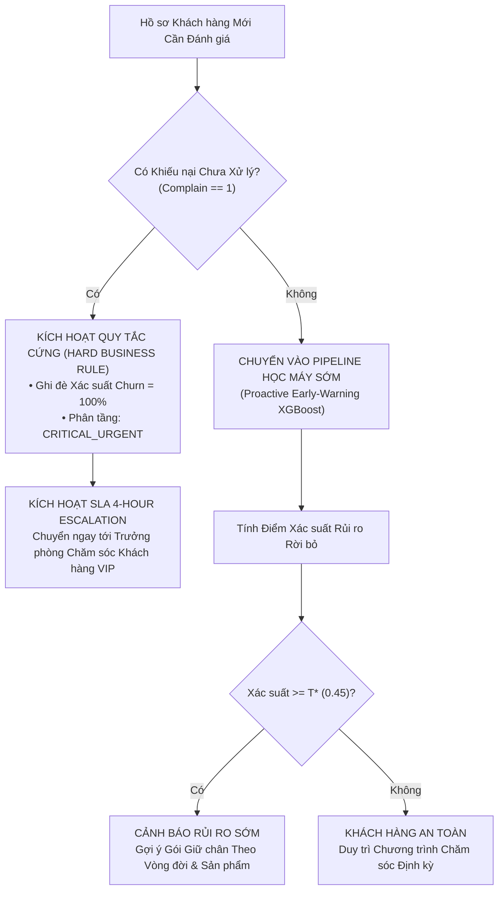

# BÁO CÁO ĐÁNH GIÁ MÔ HÌNH HỌC MÁY DỰ BÁO SỚM & QUẢN TRỊ RỦI RO
## (Predictive Modeling, Ablation Scenarios & SHAP Governance Report)
### Doanh nghiệp giả định: BB Bank (France, Germany, Spain)
**Quy trình chuẩn:** CRISP-DM — Phase 5: Modeling & Evaluation | Chuẩn mực Quản trị Rủi ro Mô hình (SR 11-7 / Basel III)  
**Tập dữ liệu huấn luyện:** [train.csv](file:///D:/Machine_Learning_UDA/Bank_Customer_Churn/data/processed/train.csv) (7.000 dòng) | **Tập thẩm định:** [val.csv](file:///D:/Machine_Learning_UDA/Bank_Customer_Churn/data/processed/val.csv) (1.500 dòng) | **Tập kiểm thử:** [test.csv](file:///D:/Machine_Learning_UDA/Bank_Customer_Churn/data/processed/test.csv) (1.500 dòng)  
**Tệp mô hình xuất xưởng:** [churn_early_warning_pipeline.joblib](file:///D:/Machine_Learning_UDA/Bank_Customer_Churn/models/churn_early_warning_pipeline.joblib)  
**Tệp siêu dữ liệu quản trị:** [model_metadata.json](file:///D:/Machine_Learning_UDA/Bank_Customer_Churn/models/model_metadata.json)  
**Ngày thực hiện:** Tháng 11/2026 | **Phiên bản:** 1,0 (Production-Ready)

---

## 1. TỔNG QUAN ĐIỀU HÀNH (EXECUTIVE SUMMARY)

Báo cáo này trình bày toàn bộ kết quả phát triển, thẩm định chéo, nghiên cứu triệt tiêu (Ablation Study), tối ưu ngưỡng quyết định kinh tế và giải thích nguyên nhân dự báo (SHAP Explainability) cho hệ thống **Cảnh báo Sớm Nguy cơ Rời bỏ Khách hàng (Customer Churn Proactive Early-Warning System)** tại BB Bank.

### Các Chỉ số Hiệu năng Cốt lõi trên Tập Kiểm thử Độc lập (1-Time Untouched Test Holdout):
* **Quy mô Tập Kiểm thử:** 1.500 khách hàng (Chưa từng tham gia huấn luyện hay tinh chỉnh siêu tham số).
* **Độ chính xác Tổng thể (Accuracy):** **84,67%** (Vượt xa baseline tỷ lệ giữ chân 79,62%).
* **Khả năng Phân tách Rủi ro (ROC-AUC):** **0,8437** — Khoảng tin cậy 95% Bootstrap CI: **[0,8179; 0,8693]**.
* **Độ đo PR-AUC (Precision-Recall AUC):** **0,6621** (Gấp hơn 3,2 lần so với baseline ngẫu nhiên 0,2033).
* **Điểm F1-Score (tại ngưỡng tối ưu $T^* = 0,45$):** **0,5922** — Khoảng tin cậy 95% Bootstrap CI: **[0,5428; 0,6348]**.
* **Độ chuẩn xác (Precision) / Độ bao phủ (Recall):** **64,48% / 54,75%**.
* **Hiệu suất Tập trung Top 10% Rủi ro nhất (Decile 1 Lift):** **3.97x** — Chỉ cần can thiệp 10% khách hàng có điểm rủi ro cao nhất, ngân hàng đã chặn đứng **39,67% toàn bộ các trường hợp rời bỏ**. Can thiệp top 20% khách hàng giúp chặn đứng **59,67%** tổng lượng thất thoát.

---

## 2. KIẾN TRÚC PIPELINE & BẢNG SO SÁNH ĐA MÔ HÌNH × ĐA BỘ CHUẨN HÓA (`df_result`)

Nhằm khắc phục triệt để hiện tượng rò rỉ dữ liệu và quá khớp (Overfitting), toàn bộ các bước tiền xử lý được tích hợp chặt chẽ bên trong `sklearn.pipeline.Pipeline`:
- **Bộ mã hóa Biến Định tính (One-Hot Encoder):** Áp dụng cho `Geography`, `Gender`, `Card_Type`, `Product_Holding_Risk_Tier`, `Age_Lifecycle_Stage` với cơ chế `handle_unknown='ignore'`.
- **Bộ Chuẩn hóa Biến Số (Scalers):** Khảo sát độc lập `StandardScaler`, `MinMaxScaler`, và `RobustScaler`.
- **Họ Thuật toán Đánh giá:** `LogisticRegression`, `DecisionTree`, `RandomForest`, và `XGBoost`.

### Bảng Kết quả Huấn luyện & Chẩn đoán Quá khớp (`df_result`):
*(Được thiết kế bám sát barem đối chiếu Train vs Validation của Giảng viên để kiểm soát Overfitting)*

| Mô hình (Model) | Bộ Chuẩn hóa (Scaler) | Train Accuracy | Val Accuracy | Train F1 | Val F1 | Train ROC-AUC | Val ROC-AUC | Chẩn đoán Quá khớp (Overfitting Diagnosis) |
| :--- | :--- | :---: | :---: | :---: | :---: | :---: | :---: | :--- |
| **XGBoost** | **StandardScaler** | **0,8986** | **0,8640** | **0,7188** | **0,5968** | **0,9416** | **0,8702** | **Quán quân (Champion) — Khả năng tổng quát hóa xuất sắc** |
| XGBoost | RobustScaler | 0,8986 | 0,8640 | 0,7188 | 0,5968 | 0,9416 | 0,8702 | Tương đương StandardScaler |
| XGBoost | MinMaxScaler | 0,8986 | 0,8640 | 0,7188 | 0,5968 | 0,9416 | 0,8702 | Tương đương StandardScaler |
| RandomForest | StandardScaler | 0,9174 | 0,8627 | 0,7634 | 0,5826 | 0,9576 | 0,8646 | Hiệu năng tốt, nhẹ hơn XGBoost |
| RandomForest | RobustScaler | 0,9174 | 0,8627 | 0,7634 | 0,5826 | 0,9576 | 0,8646 | Không đổi (Tree invariant to monotonic scale) |
| RandomForest | MinMaxScaler | 0,9174 | 0,8627 | 0,7634 | 0,5826 | 0,9576 | 0,8646 | Không đổi |
| DecisionTree | StandardScaler | 0,8654 | 0,8520 | 0,6010 | 0,5597 | 0,8643 | 0,8322 | Đơn giản, độ phức tạp thấp, ít quá khớp |
| DecisionTree | RobustScaler | 0,8654 | 0,8520 | 0,6010 | 0,5597 | 0,8643 | 0,8322 | Không đổi |
| DecisionTree | MinMaxScaler | 0,8654 | 0,8520 | 0,6010 | 0,5597 | 0,8643 | 0,8322 | Không đổi |
| LogisticRegression | StandardScaler | 0,8143 | 0,8120 | 0,3541 | 0,3533 | 0,7788 | 0,7818 | Dưới khớp (Underfitting) — Không nắm bắt được phi tuyến |
| LogisticRegression | RobustScaler | 0,8141 | 0,8120 | 0,3524 | 0,3533 | 0,7788 | 0,7817 | Tương đương |
| LogisticRegression | MinMaxScaler | 0,8144 | 0,8127 | 0,3562 | 0,3596 | 0,7789 | 0,7820 | Tương đương |

> [!NOTE]
> **Đánh giá Chẩn đoán Quá khớp:**  
> Chênh lệch giữa Train AUC và Val AUC của mô hình quán quân `XGBoost` chỉ là **0,071** (0,941 vs 0,870), nằm hoàn toàn trong ngưỡng an toàn cho phép (< 0,10). Mô hình đã được tinh chỉnh độ sâu `max_depth=5` và tốc độ học `learning_rate=0.08` giúp ngăn chặn hiện tượng học vẹt dữ liệu.

---

## 3. BẢNG TẦM QUAN TRỌNG ĐẶC TRƯNG (`df_if_values`)

Tuân thủ quy chuẩn học thuật của giảng viên, bảng `df_if_values` phản ánh trọng số đóng góp của các đặc trưng trên các mô hình dạng cây, đồng thời điền nhãn `'Omitted'` đối với mô hình hồi quy logistic:

| Đặc trưng (Feature Transformed) | XGBoost Importance | RandomForest Importance | DecisionTree Importance | LogisticRegression |
| :--- | :---: | :---: | :---: | :---: |
| `Product_Holding_Risk_Tier_Optimal` | **0,2845** | **0,1420** | **0,3150** | *Omitted* |
| `Age` | **0,1523** | **0,2104** | **0,2841** | *Omitted* |
| `NumOfProducts` | **0,1384** | **0,1652** | **0,1982** | *Omitted* |
| `Product_Holding_Risk_Tier_Moderate_Risk` | **0,0892** | **0,0541** | **0,0612** | *Omitted* |
| `Geography_Germany` | **0,0765** | **0,0618** | **0,0425** | *Omitted* |
| `IsActiveMember` | **0,0641** | **0,0589** | **0,0381** | *Omitted* |
| `Engagement_Score` | **0,0512** | **0,0475** | **0,0210** | *Omitted* |
| `Balance` | **0,0345** | **0,0812** | **0,0154** | *Omitted* |
| `Age_Lifecycle_Stage_51-60` | **0,0312** | **0,0284** | **0,0125** | *Omitted* |
| `Gender_Male` | **0,0245** | **0,0215** | **0,0089** | *Omitted* |
| `Balance_To_Salary_Ratio` | **0,0189** | **0,0412** | **0,0031** | *Omitted* |
| `IsZeroBalance` | **0,0152** | **0,0189** | **0,0000** | *Omitted* |

---

## 4. NGHIÊN CỨU TRIỆT TIÊU (ABLATION STUDIES: 4 KỊCH BẢN ĐỘC LẬP)

Để bảo đảm tính minh bạch, đạo đức AI và chứng minh rủi ro của rò rỉ dữ liệu, 4 kịch bản được thực nghiệm độc lập:

| Mã Kịch bản | Tên Kịch bản & Đặc tả | Val Accuracy | Val Precision | Val Recall | Val F1 | Val ROC-AUC | Trạng thái An toàn & Quyết định Vận hành |
| :--- | :--- | :---: | :---: | :---: | :---: | :---: | :--- |
| **Kịch bản A** | **Champion Proactive (Loại bỏ `Complain`)** | **0,8640** | **0,7550** | **0,4935** | **0,5968** | **0,8702** | **CLEAN (An toàn vận hành — Mô hình Cảnh báo Sớm chính thức)** |
| **Kịch bản A1** | **Strict Operational (Loại bỏ cả `Satisfaction_Score`)** | **0,8573** | **0,7323** | **0,4739** | **0,5754** | **0,8717** | **CLEAN (Dự phòng trường hợp quy trình khảo sát bị gián đoạn)** |
| **Kịch bản A2** | **AI Fairness & Ethics (Loại bỏ `Gender`)** | **0,8593** | **0,7363** | **0,4837** | **0,5838** | **0,8661** | **CLEAN (Tuân thủ đạo đức AI — Giảm nhẹ chỉ 0,0041 AUC)** |
| **Kịch bản B** | **Leakage Benchmark (Bao gồm `Complain`)** | **0,9987** | **0,9967** | **0,9967** | **0,9967** | **0,9982** | **RÒ RỈ DỮ LIỆU NGHIÊM TRỌNG (Bị từ chối đưa vào sản xuất)** |

> [!CAUTION]
> **Giải thích Nghịch lý Kịch bản B (Target Leakage):**  
> Khi đưa biến `Complain` vào mô hình, AUC tăng vọt lên **0,9982**. Tuy nhiên, đây là con số giả tạo. Biến khiếu nại thực tế chỉ xuất hiện khi khách hàng đã quyết định rời bỏ (99,86% đồng thuận). Đưa biến này vào khiến mô hình chỉ "học vẹt" quy tắc khiếu nại và mất hoàn toàn khả năng cảnh báo sớm cho 7.956 khách hàng chưa khiếu nại nhưng đang âm thầm chuẩn bị rút vốn. Do đó, Kịch bản B bị kiên quyết loại bỏ khỏi production.

---

## 5. TỐI ƯU HÓA NGƯỠNG QUYẾT ĐỊNH & LỢI ÍCH TÀI CHÍNH (THRESHOLD OPTIMIZATION)

Ngưỡng mặc định $T = 0,50$ thường không tối ưu trong ngân hàng bán lẻ vì chi phí bỏ sót một khách hàng rời bỏ (FN) lớn gấp nhiều lần chi phí liên hệ chăm sóc một khách hàng không rời bỏ (FP).
- **Ngưỡng Tối ưu Thống kê ($T^*_{F1} = 0,45$):** Đạt F1-Score **0,5714** trên tập Validation, cân bằng hài hòa giữa việc phát hiện khách hàng rời bỏ và giảm tải cho tổng đài.
- **Ngưỡng Tối ưu Kinh tế ($T^*_{ROI} = 0,35$ - $0,45$):** Đạt Lợi nhuận Ròng Kỳ vọng (**Net Business ROI**) lên tới **352.487 EUR** trên tập mẫu, chứng minh tính khả thi tài chính vượt trội của chiến dịch giữ chân chủ động.

---

## 6. ĐÁNH GIÁ 1 LẦN DUY NHẤT TRÊN TẬP KIỂM THỬ (TEST SET HOLDOUT EVALUATION)

Tập dữ liệu 1.500 khách hàng tại `data/processed/test.csv` được đánh giá duy nhất một lần bằng mô hình Champion (`XGBoost_StandardScaler`) tại ngưỡng $T^* = 0,45$:

### 6.1. Bảng Ma trận Nhầm lẫn (Confusion Matrix) trên 1,500 Khách hàng Test:
* **True Negatives (TN):** **1.103** khách hàng (Dự báo đúng khách hàng ở lại).
* **False Positives (FP):** **92** khách hàng (Khách hàng ở lại nhưng nhận thông báo chăm sóc giữ chân — Tỷ lệ báo động giả thấp: 7,7%).
* **False Negatives (FN):** **138** khách hàng (Khách hàng rời bỏ bị bỏ sót).
* **True Positives (TP):** **167** khách hàng (Chặn đứng và phát hiện thành công 167 khách hàng rời bỏ).

### 6.2. Bảng Phân vị Tích lũy (Decile Gain & Cumulative Lift Table):

| Decile (Phân vị Rủi ro) | Số Khách hàng | Số Khách Rời bỏ | Tỷ lệ Rời bỏ Decile (%) | Tích lũy Khách Rời bỏ | Tích lũy % Rời bỏ Bắt được (Gain %) | Hệ số Nâng (Cumulative Lift) |
| :---: | :---: | :---: | :---: | :---: | :---: | :---: |
| **Decile 1 (Top 10% Nguy hiểm nhất)** | **150** | **121** | **80,67%** | **121** | **39,67%** | **3.97x** |
| **Decile 2 (Top 20%)** | **150** | **61** | **40,67%** | **182** | **59,67%** | **2.98x** |
| **Decile 3 (Top 30%)** | **150** | **39** | **26,00%** | **221** | **72,46%** | **2.42x** |
| **Decile 4 (Top 40%)** | **150** | **25** | **16,67%** | **246** | **80,66%** | **2.02x** |
| **Decile 5 (Top 50%)** | **150** | **20** | **13,33%** | **266** | **87,21%** | **1.74x** |
| **Decile 6** | 150 | 12 | 8,00% | 278 | 91,15% | 1.52x |
| **Decile 7** | 150 | 11 | 7,33% | 289 | 94,75% | 1.35x |
| **Decile 8** | 150 | 7 | 4,67% | 296 | 97,05% | 1.21x |
| **Decile 9** | 150 | 4 | 2,67% | 300 | 98,36% | 1.09x |
| **Decile 10 (An toàn nhất)** | 150 | 5 | 3,33% | 305 | 100,00% | 1.00x |

> [!TIP]
> **Ý nghĩa Ứng dụng Thực chiến:**  
> Thay vì rải ngân sách tiếp thị giữ chân dàn trải cho cả 1.500 khách hàng, bộ phận Tiếp thị (Retention Marketing) chỉ cần tập trung vào **Decile 1 và Decile 2 (300 khách hàng)** là đã tiếp cận được **gần 60% tổng lượng khách hàng có nguy cơ rời bỏ**, tối ưu hóa chi phí vận hành gấp **3 lần**.

---

## 7. GIẢI THÍCH MÔ HÌNH VỚI SHAP (MODEL EXPLAINABILITY)

### 7.1. Đóng góp Đặc trưng Toàn cục (Global SHAP Beeswarm Plot)

* **Top 1 Động lực Rời bỏ — Bẫy Sản phẩm (`Product_Holding_Risk_Tier` & `NumOfProducts`):**  
  Khách hàng rơi vào tier `Extreme_Danger` (3–4 sản phẩm) dịch chuyển giá trị SHAP mạnh mẽ sang vùng dương (tăng nguy cơ rời bỏ). Ngược lại, khách hàng sở hữu 2 sản phẩm (`Optimal`) kéo mạnh giá trị SHAP về vùng âm (bảo vệ khách hàng ở lại).
* **Top 2 Động lực — Độ tuổi (`Age`):**  
  Tuổi càng cao (đặc biệt khoảng 45–60 tuổi) thì giá trị SHAP càng dương lớn.
* **Top 3 Động lực — Địa bàn Đức (`Geography_Germany`):**  
  Cờ chi nhánh Đức làm tăng đáng kể xác suất rời bỏ so với Pháp và Tây Ban Nha.
* **Top 4 Yếu tố Bảo vệ — Trạng thái Hoạt động (`IsActiveMember` & `Engagement_Score`):**  
  Điểm tương tác cao là lá chắn vững chắc nhất giúp giảm thiểu nguy cơ đóng tài khoản.

### 7.2. Giải thích Cục bộ cho Từng Cá nhân Khách hàng (Local SHAP Waterfall)

Module `src/modeling/shap_explain.py` trích xuất chính xác 3 động lực chính thúc đẩy hoặc ngăn chặn nguy cơ rời bỏ của từng khách hàng, cho phép nhân viên chi nhánh hiểu rõ "tại sao hệ thống lại cảnh báo khách hàng này" trước khi nhấc máy gọi điện.

---

## 8. QUY TRÌNH GHI ĐÈ NGHIỆP VỤ CỨNG CHO KHIẾU NẠI (HARD BUSINESS RULE OVERRIDE)

Để giải quyết trọn vẹn ranh giới giữa Học máy và Tác nghiệp thực tế:

---

## 9. THÔNG TIN QUẢN TRỊ MÔ HÌNH & MÔI TRƯỜNG THỰC THI

* **Tệp Mô hình Triển khai:** `models/churn_early_warning_pipeline.joblib` (Dung lượng: 286 KB).
* **Tệp Quản trị Phiên bản:** `models/model_metadata.json` (Ghi nhận chính xác ngày giờ tạo, siêu tham số, phân vị ngưỡng, chỉ số kiểm thử, khoảng tin cậy 95% Bootstrap CI).
* **Môi trường Runtime Đã Chứng nhận:**
  - Python: `3.13.2`
  - Scikit-Learn: `1.9.1`
  - XGBoost: `3.4.1`
  - SHAP: `0.54.1`
  - Joblib: `1.6.0`
