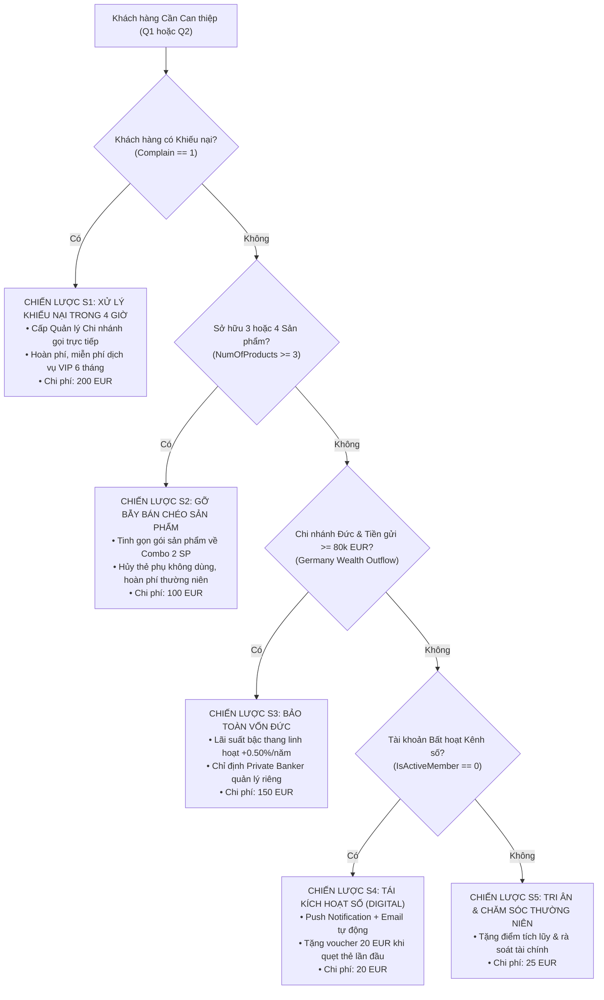
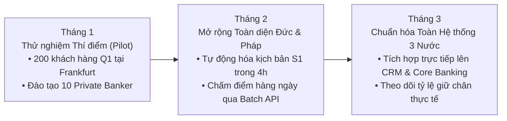

# SỔ TAY CHIẾN LƯỢC KINH DOANH & PHÂN TÍCH ĐỀ XUẤT GIỮ CHÂN KHÁCH HÀNG
## (Prescriptive Business Strategy & Customer Retention Playbook)
### Doanh nghiệp giả định: BB Bank (France, Germany, Spain)
**Quy trình chuẩn:** Gartner Level 4: Prescriptive Analytics | Chiến lược Quản trị Dòng tiền & Trải nghiệm Khách hàng  
**Tập dữ liệu phân tích:** [full_engineered.csv](file:///D:/Machine_Learning_UDA/Bank_Customer_Churn/data/processed/full_engineered.csv) (10.000 khách hàng toàn ngân hàng)  
**Mô hình vận hành:** [churn_early_warning_pipeline.joblib](file:///D:/Machine_Learning_UDA/Bank_Customer_Churn/models/churn_early_warning_pipeline.joblib)  
**Ngày ban hành:** Tháng 11/2026 | **Phiên bản:** 1,0 (Production-Ready)

---

## 1. TỔNG QUAN CHIẾN LƯỢC (EXECUTIVE SUMMARY)

Chuyển dịch từ việc "dự báo ai sẽ rời bỏ" (Predictive) sang "ngân hàng cần làm gì cụ thể với từng khách hàng để bảo toàn dòng tiền" (Prescriptive), **Sổ tay Chiến lược Giữ chân Khách hàng (Retention Playbook)** thiết lập cơ chế phân bổ nguồn lực dựa trên hai trục giá trị: **Vốn huy động (Deposit Value)** và **Mức độ Rủi ro Rời bỏ (Predicted Risk)**.

### Tóm tắt Hiệu quả Kinh tế Chiến dịch Giữ chân Toàn diện (Total Portfolio ROI):
* **Tổng số Khách hàng Tiếp cận:** **2.653 khách hàng** (chiếm 26,53% tổng quy mô khách hàng toàn ngân hàng).
* **Tổng Ngân sách Can thiệp Dự kiến:** **303.700 EUR**.
* **Số Khách hàng Giữ chân Thành công Kỳ vọng:** **720 khách hàng**.
* **Dòng tiền Tiền gửi Bảo toàn Trực tiếp:** **73,95 triệu EUR** (Bảo vệ hơn 73 triệu EUR vốn huy động khỏi nguy cơ rút sạch).
* **Giá trị Vòng đời Khách hàng (CLV) Bảo toàn:** **3,84 triệu EUR**.
* **Lợi nhuận Ròng Kỳ vọng (Net Profit):** **3,54 triệu EUR** (3.537.998 EUR).
* **Tỷ suất Sinh lời của Chiến dịch (ROI):** **1.164,96%** (Mỗi 1 EUR đầu tư mang lại 11,65 EUR lợi nhuận ròng).

---

## 2. MA TRẬN PHÂN KHÚC 4 GÓC PHẦN TƯ (VALUE × RISK 4-QUADRANTS MATRIX)


Để tránh lãng phí ngân sách vào việc can thiệp đại trà, toàn bộ 10.000 khách hàng được định vị trên ma trận 2 chiều:
- **Trục Hoành (Trục Giá trị - Balance):** Ngưỡng phân định khách hàng giá trị cao (VIP / Affluent) là **80.000 EUR** số dư tiền gửi.
- **Trục Tung (Trục Rủi ro - Risk Probability):** Ngưỡng quyết định rủi ro tối ưu $T^* = \mathbf{0,45}$ từ mô hình Machine Learning.

### Bảng Chỉ số Hoạt động Theo 4 Góc Phần tư:

| Góc Phần tư (Quadrant) | Mô tả & Định vị Chiến lược | Số Khách hàng | Tỷ lệ Khách (%) | Tổng Tiền gửi (M EUR) | Tỷ lệ Vốn (%) | Tiền gửi Trung bình | Rủi ro Dự báo TB | Churn Thực tế (%) |
| :--- | :--- | :---: | :---: | :---: | :---: | :---: | :---: | :---: |
| **Q1: VIP At-Risk** | **VIP Nguy cơ Cao (High Value, High Risk)** | **1.899** | **18,99%** | **242.81M** | **31,75%** | **127.864 EUR** | **90,18%** | **74,14%** |
| **Q2: Standard At-Risk** | **Phổ thông Nguy cơ Cao (Low Value, High Risk)** | **754** | **7,54%** | **9.32M** | **1,22%** | **12.359 EUR** | **93,35%** | **83,29%** |
| **Q3: VIP Loyal** | **VIP Trung thành (High Value, Low Risk)** | **3.899** | **38,99%** | **483.73M** | **63,24%** | **124.065 EUR** | **16,00%** | **0,03%** |
| **Q4: Standard Loyal** | **Phổ thông Trung thành (Low Value, Low Risk)** | **3.448** | **34,48%** | **29.00M** | **3,79%** | **8.410 EUR** | **13,42%** | **0,03%** |

> [!IMPORTANT]
> **Tâm điểm Chi viện Chiến lược (Strategic Focus):**  
> Phân khúc **Q1 (VIP At-Risk)** chỉ có 1.899 khách hàng nhưng nắm giữ tới **242,81 triệu EUR (chiếm gần 32% tổng vốn của ngân hàng)** và có tỷ lệ rời bỏ thực tế lên tới **74,14%**. Đây chính là "tâm chấn thất thoát vốn" cần tập trung 90% nỗ lực chăm sóc trực tiếp từ các cấp quản lý và Private Banker.

---

## 3. ĐỘNG CƠ ĐỀ XUẤT HÀNH ĐỘNG TIẾP THEO TỐI ƯU (NEXT-BEST-ACTION ENGINE)

Thay vì đưa ra các chương trình khuyến mãi giảm giá chung chung, Động cơ Next-Best-Action (NBA) tại [src/business/retention_advisor.py](file:///D:/Machine_Learning_UDA/Bank_Customer_Churn/src/business/retention_advisor.py) kích hoạt 5 chiến lược chuyên biệt dựa trên căn nguyên số liệu đã được chứng minh qua EDA và SHAP:



### Bảng Chi tiết 5 Chiến lược Giữ chân Chuyên sâu:

1. **Chiến lược S1 — Ưu tiên Khẩn cấp Cấp 1 (SLA 4-Hour Complaint Escalation):**
   - *Đối tượng:* Khách hàng có `Complain == 1`.
   - *Hành động:* Trưởng phòng Chăm sóc Khách hàng chi nhánh gọi điện trực tiếp trong 4 giờ. Lắng nghe, xin lỗi chân thành, hoàn 100% phí gây bức xúc và cấp thẻ VIP miễn phí 6 tháng.
   - *Kênh:* Điện thoại trực tiếp từ cấp Quản lý Chi nhánh.
2. **Chiến lược S2 — Gỡ bẫy Bán chéo & Hợp nhất Sản phẩm (Product Rationalization):**
   - *Đối tượng:* Khách hàng có `NumOfProducts >= 3` (tỷ lệ rời bỏ tự nhiên 85,9%).
   - *Hành động:* Rà soát các tài khoản phụ/thẻ phụ ít phát sinh giao dịch; hoàn phí thường niên năm gần nhất; tư vấn gom gọn lại gói Combo 2 sản phẩm tối ưu (Tài khoản thanh toán chính + Thẻ tín dụng hoàn tiền).
   - *Kênh:* Chuyên viên Quan hệ Khách hàng (RM).
3. **Chiến lược S3 — Đặc quyền Bảo toàn Dòng vốn Đức (German Wealth Protection):**
   - *Đối tượng:* Khách hàng chi nhánh Đức có số dư $\ge 80.000$ EUR (khắc phục tâm chấn 97.97M EUR thất thoát).
   - *Hành động:* Đề xuất gói tiền gửi kỳ hạn linh hoạt lãi suất cộng thêm +0,50%/năm để cạnh tranh sòng phẳng với các ngân hàng nội địa Đức; miễn phí chuyển tiền quốc tế; chỉ định Private Banker riêng.
   - *Kênh:* Chuyên viên Quản lý Tài sản (Private Banker).
4. **Chiến lược S4 — Tái kích hoạt Tương tác Kênh số (Digital Re-engagement):**
   - *Đối tượng:* Khách hàng không hoạt động (`IsActiveMember == 0`).
   - *Hành động:* Kích hoạt thông báo đẩy trên App Mobile Banking, tặng e-voucher 20 EUR khi thực hiện giao dịch thanh toán hóa đơn đầu tiên trong tháng.
   - *Kênh:* Digital Marketing tự động (Push App + Email).
5. **Chiến lược S5 — Tri ân & Rà soát Sức khỏe Danh mục Thường niên (Loyalty Maintenance):**
   - *Đối tượng:* Khách hàng rủi ro mức độ vừa.
   - *Hành động:* Tặng điểm thưởng Loyalty Reward Points và thư mời đến phòng chờ thương gia chi nhánh để chuyên viên rà soát danh mục đầu tư.
   - *Kênh:* Email + SMS tự động.

---

## 4. QUY TRÌNH TIẾP CẬN KHÁCH HÀNG & KỊCH BẢN CUỘC GỌI CHO CHUYÊN VIÊN (FRONT-LINE CALL SCRIPT)

### Nguyên tắc Đạo đức AI & Bảo mật Dữ liệu (GDPR / AI Ethics):
> [!CAUTION]
> **Tuyệt đối Không Tiết lộ Điểm Rủi ro AI cho Khách hàng:**  
> Chuyên viên RM tuyệt đối **KHÔNG ĐƯỢC** nói các câu như: *"Hệ thống AI của ngân hàng báo anh/chị có nguy cơ rời bỏ 85%"*. Thay vào đó, cuộc gọi phải xuất phát từ vị thế **Tri ân, Chăm sóc Chủ động và Gia tăng Giá trị** cho khách hàng.

### Kịch bản Cuộc gọi Tiêu chuẩn (Trường hợp Khách hàng Đức có Số dư Lớn):
```text
================================================================================
KỊCH BẢN CHĂM SÓC KHÁCH HÀNG CÁ NHÂN HÓA (FRONT-LINE RETENTION CALL SCRIPT)
Ngân hàng: BB Bank | Khách hàng: Anh Müller | Chi nhánh: Germany
Chuyên viên phụ trách: Nguyễn Văn Bảo | Mã chiến lược: S3_GERMAN_WEALTH_LOCK
================================================================================

[BƯỚC 1: LỜI CHÀO & TẠO SỰ GẮN KẾT ẤM ÁP]
"Dạ, em chào Anh Müller! Em là Nguyễn Văn Bảo, Chuyên viên Quản lý Tài sản Khách hàng Cao cấp tại BB Bank chi nhánh Frankfurt.
Trước hết, thay mặt ban lãnh đạo ngân hàng, em xin chân thành cảm ơn Anh đã đồng hành và tin tưởng gửi gắm dòng vốn tại BB Bank trong suốt 5 năm qua.
Hôm nay em liên hệ trực tiếp để hỏi thăm tình hình giao dịch của Anh và cập nhật một số chính sách ưu đãi vốn mới nhất của ngân hàng dành riêng cho phân khúc khách hàng thân thiết ạ."

[BƯỚC 2: TIẾP CẬN TẾ NHỊ DỰA TRÊN ĐẶC TRƯNG HÀNH VI]
"Dạ thưa Anh Müller, với tư cách là một trong những khách hàng tiền gửi tiêu biểu tại chi nhánh Đức, ngân hàng chúng em hiểu rằng việc tối ưu hóa lợi suất và bảo toàn thanh khoản linh hoạt là ưu tiên hàng đầu của Anh trong bối cảnh thị trường hiện nay..."

[BƯỚC 3: GIỚI THIỆU GÓI GIẢI PHÁP GIỮ CHÂN (NEXT-BEST-ACTION OFFER)]
"Dạ, ngân hàng em vừa chính thức triển khai gói đặc quyền 'Bảo toàn & Tăng trưởng Vốn 2026'. Với gói này, khoản tiền gửi của Anh sẽ được áp dụng chính sách lãi suất kỳ hạn linh hoạt với mức cộng thêm ưu đãi +0.50%/năm so với biểu lãi suất thông thường, đồng thời miễn 100% phí giao dịch quốc tế. Ngoài ra, em sẽ là chuyên viên đồng hành trực tiếp để hỗ trợ mọi nhu cầu tài chính cá nhân của Anh bất kỳ lúc nào ạ."

[BƯỚC 4: LỜI KẾT & XÁC NHẬN HÀNH ĐỘNG]
"Dạ, em xin phép gửi thông tin chi tiết qua email cá nhân của Anh ngay sau cuộc gọi này. 
Số điện thoại trực tiếp của em là [SĐT Nội bộ/Di động]. Bất kỳ lúc nào Anh cần hỗ trợ, Anh cứ gọi thẳng cho em nhé ạ! 
Em chúc Anh Müller một ngày làm việc thật nhiều niềm vui và thành công ạ!"
================================================================================
```

---

## 5. MÔ HÌNH TÀI CHÍNH LỢI NHUẬN RÒNG ĐA TẦNG (TIERED ROI MODEL)


### Bảng Cân đối Kinh tế Chi tiết của Chiến dịch Giữ chân:

| Chỉ số Kinh tế (Financial Metric) | Phân khúc Q1: VIP Nguy cơ Cao | Phân khúc Q2: Phổ thông Nguy cơ Cao | Toàn bộ Chiến dịch (Total Portfolio) |
| :--- | :---: | :---: | :---: |
| **Quy mô Khách hàng Can thiệp** | **1.899 khách hàng** | **754 khách hàng** | **2.653 khách hàng** |
| **Chi phí Can thiệp trên mỗi Khách hàng** | 150 EUR (Private Banker) | 25 EUR (Kênh số tự động) | Bình quân: 114,47 EUR |
| **Tổng Ngân sách Can thiệp** | **284.850 EUR** | **18.850 EUR** | **303.700 EUR** |
| **Tỷ lệ Giữ chân Thành công Dự kiến** | **40,0%** (Tư vấn 1-1) | **25,0%** (Voucher số) | Tỷ lệ tổng thể: 35,7% |
| **Số Khách hàng Giữ chân Thành công** | **563,2 khách hàng** | **157,0 khách hàng** | **720,2 khách hàng** |
| **Dòng tiền Tiền gửi Bảo toàn** | **72,01 triệu EUR** | **1,94 triệu EUR** | **73,95 triệu EUR** |
| **Giá trị Vòng đời (CLV) Bảo toàn** | **3.713.281 EUR** | **128.418 EUR** | **3.841.699 EUR** |
| **Lợi nhuận Ròng Kỳ vọng (Net Profit)** | **3.428.431 EUR** | **109.568 EUR** | **3.537.999 EUR** |
| **Tỷ suất Sinh lời ROI (%)** | **1.203,59%** | **581,26%** | **1.164,96%** |

> [!TIP]
> **Đánh giá Hiệu quả Đầu tư:**  
> - Phân khúc **Q1 (VIP At-Risk)** mang lại **96,9% tổng lợi nhuận ròng** của toàn chiến dịch (3.43M EUR / 3.54M EUR).
> - Phân khúc **Q2 (Standard At-Risk)** dù số dư nhỏ nhưng nhờ chi phí can thiệp số hóa siêu tiết kiệm (chỉ 25 EUR/khách), chiến dịch vẫn đạt ROI **581,26%**, đóng góp tích cực vào việc giữ gìn uy tín thương hiệu ngân hàng bán lẻ.

---

## 6. LỘ TRÌNH TRIỂN KHAI VẬN HÀNH (OPERATIONAL ROADMAP)



1. **Giai đoạn Thí điểm (Pilot Phase - 4 tuần):**  
   Triển khai thí điểm trên 200 khách hàng thuộc phân khúc Q1 tại chi nhánh Frankfurt (Đức). Đo lường tỷ lệ tiếp nhận gói lãi suất ưu đãi và hoàn thiện kịch bản gọi điện.
2. **Giai đoạn Triển khai Kênh số Tự động (Automation Phase - 4 tuần):**  
   Kết nối quy tắc cảnh báo khiếu nại (SLA 4-Hour Escalation) vào hệ thống tổng đài tự động và phân luồng cuộc gọi cho Trưởng phòng CSKH.
3. **Giai đoạn Tích hợp Core Banking & Đánh giá Thường kỳ (Governance Phase):**  
   Chạy mô hình tính điểm định kỳ hàng tuần trên toàn bộ cơ sở dữ liệu khách hàng, tự động cập nhật phân tầng rủi ro và đo lường ROI thực tế so với kỳ vọng.
